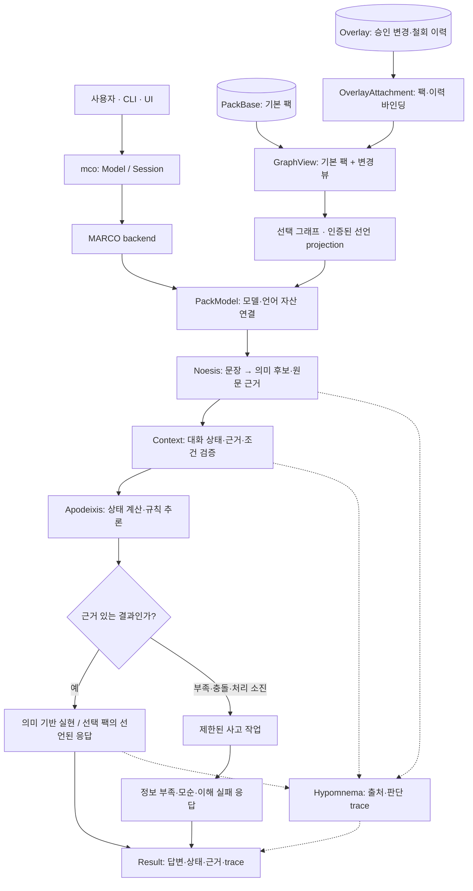
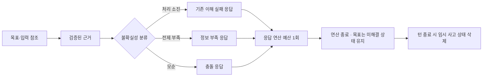
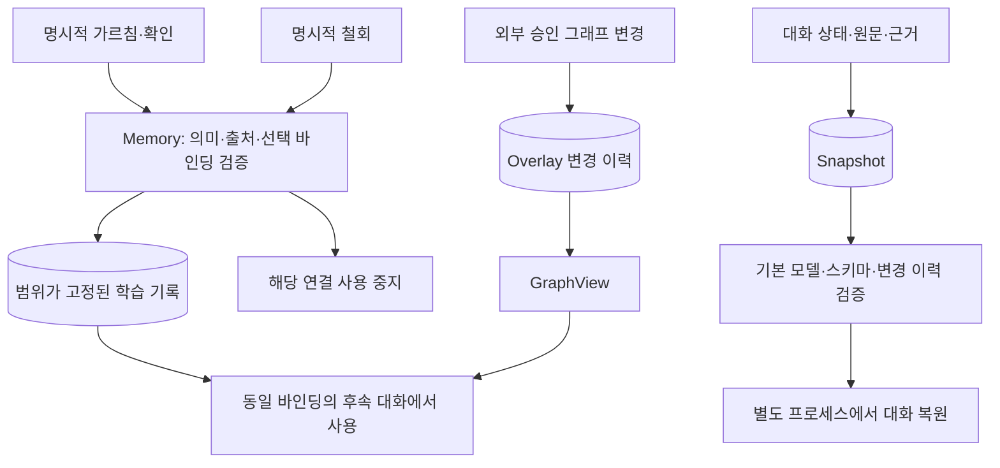

# MARCO 2

MARCO는 지식 그래프, 선언된 언어 규칙, 대화에서 얻은 근거를 사용해 답하는 추론 엔진이다. 입력을 의미 구조로 읽고, 선택한 그래프와 대화 상태에서 조건을 검증한 뒤 답하거나 판단을 보류한다. 현재 언어 처리·추론 경로에 토큰 생성 언어 모델을 호출하지 않는다.

**개발 중 · 현재 구조와 검증 상태: 2026-10-18.** MARCO 1 출시 준비는 취소됐다. 아래 결과는 로컬 개발 본체에 반영한 제한된 기능의 검증이며, MARCO 2 전체 완성이나 일반적인 문장 이해를 뜻하지 않는다.

## 전체 구조

실행 진입점은 `mco`, 모델과 언어 자산의 실행 연결은 `PackModel`, 대화의 의미 판단은 `Context`가 맡는다. 선택 그래프의 선언과 출처가 의미 해석의 기준이다.



| 책임 | 실제 위치 | 경계 |
| --- | --- | --- |
| 공개 API·세션 | [`mco/`](mco/model.py) | 모델 로드, 독립 대화, 결과, 저장·복원 |
| 모델 실행 연결 | [`pack_model.py`](pack_model.py), [`mco/backends/marco.py`](mco/backends/marco.py) | 팩 자산과 실행 상태를 연결 |
| 그래프와 변경 뷰 | [`marco/storage/graph_view.py`](marco/storage/graph_view.py), [`overlay.py`](marco/storage/overlay.py) | 기본 팩, 선택 뷰, 변경·철회 이력. 언어 의미를 자체 판정하지 않음 |
| 문장 이해 | [`relational_semantics.py`](relational_semantics.py), [`marco/language/`](marco/language/frames.py) | 선택 팩의 문법·관계 선언, 절 경계, 의미 후보, 원문 범위와 인증 |
| 대화와 추론 | [`marco/reasoning/`](marco/reasoning/context.py) | 사실·부정·조건·수정의 상태와 근거 검증 |
| 제한된 사고 작업 | [`query_work.py`](marco/reasoning/query_work.py) | 목표·근거·불확실성·연산·예산을 값으로 표현 |
| 답변 실현 | [`marco/language/realizer/`](marco/language/realizer/__init__.py) | 의미 기반 조립과 역검증. 선택 경로의 상태 응답은 팩 선언을 사용 |
| 학습 메모리 | [`marco/learning/memory.py`](marco/learning/memory.py) | 명시적으로 가르치고 검증한 표현·의미 연결의 저장·사용·철회 |
| 출처와 저장 | [`marco/trace/`](marco/trace/__init__.py), [`marco/storage/snapshot.py`](marco/storage/snapshot.py) | 판단 이력과 대화 상태 저장. trace 자체가 정답의 증명은 아님 |

`engine.py`의 기존 그래프 탐색·판정 경로와 `marco/knowledge`, `marco/perception`, `marco/host`도 존재한다. 이 모듈들의 존재가 일반 지능이나 자발적 사고 루프의 완성을 뜻하지는 않는다.

## 한 번의 사고 작업

현재 Thinking Graph는 실패 응답에 필요한 최소 구조다. 입력 처리 소진, 전제 부족, 모순을 구분하고 검증된 근거에 맞는 응답 연산 하나를 실행한다. 일반적인 가설 생성기나 자율 목표 선택기는 아직 붙이지 않았다.



중복 실행이나 예산 초과는 거절한다. 응답 연산이 완료됐다는 이유로 목표가 해결됐거나 가설이 사실이 됐다고 기록하지 않는다. 임시 사고 작업은 대화 스냅샷에 영구 저장하지 않는다.

## 학습·변경·복원



Memory, Overlay, Context는 서로 다른 책임을 가진다. 관찰이나 추론 가설을 검증 없이 영구 지식으로 승격하지 않는다. 복원할 때도 원래 선택 팩과 출처의 조건을 확인하며, 다른 그래프로 조용히 대체하지 않는다.

## 최근 실제 문장 검증

구조 검사와 실제 답변 평가는 따로 기록한다. 새 문항의 첫 답변을 저장하고, 버전을 가린 독립 판정을 먼저 고정한 뒤 비교했다. 이전에 닫힌 문항은 다시 실행하거나 재채점하지 않았다.

| 작업 | 이전 → 수정 후 | 검증 범위 |
| --- | --- | --- |
| 불확실성 분류·최소 사고 작업 | **8/10 → 10/10** | 새 대화 10개, 버전별 22입력. 조건 전제의 모순 응답 개선 |
| 두 조건의 AND 조합 | **2/10 → 10/10** | 새 대화 10개, 버전별 38입력. 아래 다섯 범주 |
| AND 대화 저장·별도 프로세스 복원 | **1/1 통과** | 별도의 새 대화, 설정 입력 3개와 복원 후 질문 1개 |

AND 비교의 범주별 결과:

| 범주 | 이전 | 수정 후 |
| --- | ---: | ---: |
| 두 전제 모두 참 | 0/2 | 2/2 |
| 하나가 거짓 | 0/2 | 2/2 |
| 하나가 누락 | 0/2 | 2/2 |
| 하나가 모순 | 0/2 | 2/2 |
| 기존 단일 조건 대조군 | 2/2 | 2/2 |

이번 조건 조합의 범위는 **명시적인 긍정 전제 두 개의 AND와 긍정 결과 한 개**, 그리고 선택 팩이 선언한 조건 어미·구분자다. 각 전제와 결과는 자기 원문 범위와 인증된 근거를 유지한다. OR, 부정 전제, 중첩 조건, 임의의 접속 표현 일반화는 아직 검증·구현 범위가 아니다.

첫 조건 조합 후보는 **2/10 → 2/10**이었고, 조건문이 보관되지 않아 별도 저장 검증도 실패했다. 이후 절 경계에서 두 번째 조건 앞 쉼표가 남는 원인을 고치고 **다른 새 문항**으로 위 결과를 얻었다. 최초 실패 기록은 그대로 보존했다. 새 공개 경계 검사 **7/7**은 구조 검사이며 위 문장 점수에 합산하지 않는다.

이 수치는 작은 범위의 기능 개선이다. 과거 일반 평가 **1/48**, 별도 역사 평가 v2 **2/108**은 그대로이며, 이번 10/10으로 대체하지 않는다. 일반 문맥 이해, 의미 학습 전체, 전체 graph/view lifecycle, MARCO 2 완성, 지식 그래프 10배 확대에서의 이해 성능은 아직 입증되지 않았다.

## 사용

Python 3.10 이상에서 이 저장소의 API와 MARCO 실행 의존성을 설치한다.

```bash
python -m pip install -e '.[marco]'
python -m mco inspect path/to/model.mco
```

모델 파일은 지식·언어 자산을 담으며, 실행에는 호환되는 MARCO 소스가 필요하다. 선택 모델마다 문장 지원 범위가 다르다.

```python
import mco

with mco.load("path/to/model.mco") as model:
    with model.session() as session:
        result = session.run("모델이 지원하는 문장")
        print(result.answer, result.status)
        print(result.evidence)
        session.snapshot("conversation.snapshot")

    with model.resume("conversation.snapshot") as resumed:
        result = resumed.run("이어서 묻는 문장")
```

설치·CLI·모델 형식과 세부 API는 [mco 가이드](docs/mco/README.md), [API 계약](docs/mco/api.md), [파일 형식](docs/mco/format-1.md)을 참고한다.

## 개발과 문서

- [문서 안내](docs/README.md): 남긴 문서의 역할과 보관 정책
- [Overlay](docs/architecture/overlay.md), [Snapshot](docs/architecture/snapshot.md): 저장·복원 계약
- [구조별 문서](docs/architecture/): 모듈별 책임과 상세 설계 기록
- [지식 그래프 작성](docs/ko/graph-authoring.md): `.kg` 저작 방법
- `tests/`: 기능 검사. 테스트 통과와 새로운 자연어 이해 성능은 구분한다.
- `tools/`: 개발·평가 도구와 고정된 계약. 과거 평가를 임의 재실행하지 않는다.
- `tts/`, `prototypes/`: 별도 하위 프로젝트

중복 설명, 과거 목표·작업 요청, 취소된 MARCO 1 출시 문서는 작업 문서에서 정리했다. 원본과 해시 목록은 [문서 보관 안내](docs/archive/README.md)에 있다. 지식으로 사용하는 `data/`·`cases/`의 Markdown과 외부 코드의 라이선스·출처 문서는 유지한다.

코드 라이선스는 [LICENSE](LICENSE), 그래프 라이선스는 [LICENSE-GRAPHS](LICENSE-GRAPHS), 기타 고지는 [NOTICE](NOTICE)를 따른다.
