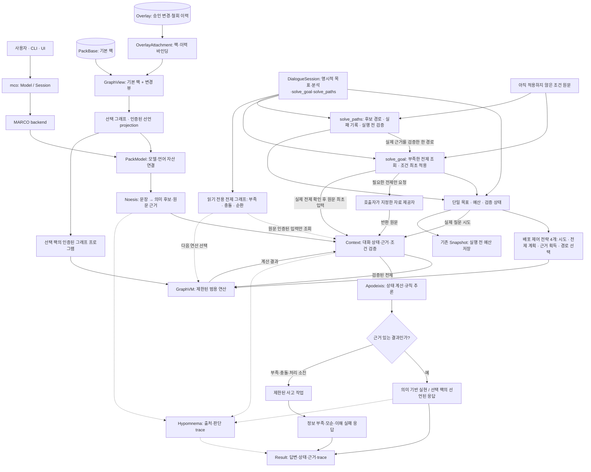
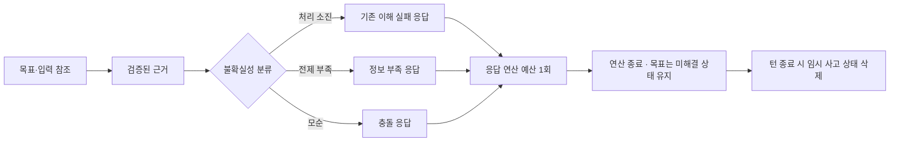
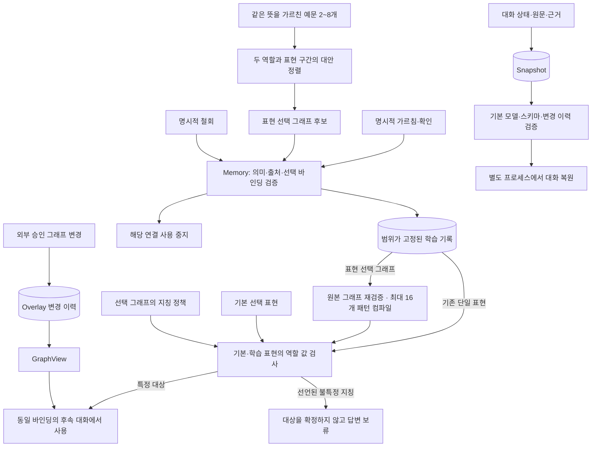

# MARCO 2

MARCO는 지식 그래프, 선언된 언어 규칙, 대화에서 얻은 근거를 사용해 답하는 추론 엔진이다. 입력을 의미 구조로 읽고, 선택한 그래프와 대화 상태에서 조건을 검증한 뒤 답하거나 판단을 보류한다. 현재 언어 처리·추론 경로에 토큰 생성 언어 모델을 호출하지 않는다.

**개발 중 · 현재 구조와 검증 상태: 2026-10-19.** MARCO 1 출시 준비는 취소됐다. 아래 결과는 로컬 개발 본체에 반영한 제한된 기능의 검증이며, MARCO 2 전체 완성이나 일반적인 문장 이해를 뜻하지 않는다.

## 여러 추론 경로의 검증·선택 — V70

`DialogueSession.solve_paths(text, *, rule_sources)`는 하나의 질문과 처음부터 제공한 사실·조건 원문에서 후보 경로를 만들고, 실행 전 검증에 실패하면 다음 경로를 고른다. 같은 결론에 도달하는 서로 다른 조건을 대안으로 다루며, 결론 자체가 여러 개면 모호함을 유지한다. GraphVM의 새 배포 제어 전략이 경로 검증·실행·정지를 선택하고, 실제 원문 적용과 답변 증명은 기존 `solve_goal`과 Context 경로에 위임한다. 별도 추론 엔진이나 사실 저장소를 만들지 않는다.

범위는 긍정 이항 사실·긍정 AND 조건 원문 최대3개, 후보 경로3개, 경로당 규칙2개·전제각2개·깊이2다. 실제 근거가 모든 말단 전제를 뒷받침하는 경로만 선택하며 다른 후보의 예상 결론을 빌려 쓰지 않는다. 실패·근거·소모 예산을 기존 Snapshot에 저장한다. 검증은 최대3회, 실제 풀이 위임은 최대1회다. 실제 실행을 시작한 뒤 실패하면 부분 변경을 보존하고 종료하며 다른 경로를 덧실행하지 않는다. 중단·손상 상태와 같은 실패 질문은 예산을 초기화해 재실행하지 못한다.

새8문제에 양쪽 모두 같은 사실과 규칙을 처음부터 전부 제공했다. 자동 과업 완료는 이전2/8→새6/8(gain4/loss0)이었다. 첫 경로 전제 부족3문제와 순환1문제를 다른 경로로 해결했고, 이미 답이 있던2문제는 유지했다. 모든 경로가 막힌2문제는 실제 질문 없이 `response=None`으로 안전 종료했다. 이 종료를 답변 정답으로 세지 않는다. 같은 정보를 받은 이전 엔진의 강한 외부 수동 경로 선택도6/8로서, 개선은 대안 경로 선택의 자동화다. 추론핵 자체의 정확도 향상이나 일반 지능 향상을 입증한 결과는 아니다.

별도 독립 의도 의미 구조를 기존 closure에 준 진단은 양쪽8/8이며, 문장의 초기 사실·질문·규칙 해석도 해당 의도와각8/8 일치했다. 이 진단은 Session의 시간순 실행 권한이나 일반 문장 이해의 증명이 아니다. 실제 질문 응답22개 원본과 별도 API 종료2개를 보존하고, 고유20개 최초 판정을 봉인한 뒤24개 결과 항목에 연결했다. 새 버전의 실제 최종 답변6개는 모두 근거 있는 정답이었다. 이전 버전의 정직한 보류를 오답 주장으로 바꾸지 않으며, 고정 집계의 `native_response_correct`는 근거 있는 답변까지 요구하는 별도 지표다. API 종료 형태 때문에 완전한 버전 은폐에는 한계가 있다.

공개 최초12/12(39검사·13별도 과정), 새 세 번째 원문 실행 경계1/1(6검사)을 통과했고 닫힌 시험은 반복하지 않았다. 평가 합산 CPU94.644829초→173.127004초는 새 경로 검증과 답변 검증 증가를 포함하므로 동일 계산량의 속도 비교가 아니다. Context·공통 VM·선택 팩·메모리 책임·SDK/UI 기본 선택은 유지한다. 학습·그래프 확대·push는 이번 범위에 포함하지 않는다.

## 전제 획득·풀이 연결 — V69

`DialogueSession.solve_goal(text, provider, *, provider_id, rule_sources)`는 아직 적용하지 않은 조건 원문에서 하위 전제를 찾고, 명시적으로 제공한 자료 제공자에게 부족한 근거를 조회한다. 받은 원문은 기존 대화 경로에서 검증·저장하고, 전제가 실제 충족된 조건만 처음 한 번 적용한 뒤 원래 질문에 다시 답한다. 예상 결론을 사실로 넣거나 과거 조건문을 다시 실행하지 않는다. GraphVM의 새 배포 제어 전략이 조회·입력·조건 적용·질문·검증을 선택한다.

범위는 긍정 이항 관계, 최대 두 개의 조건 지시, 조건별 전제 두 개와 깊이 두 단계다. 자료 조회·입력·조건 적용·원래 질문·검증은 각각 최대 두 번이다. 실행 전에 예산을 저장하고, 중단된 동작은 복원 후 반복하지 않는다. 같은 인증된 질문·제공자·조건 원문·바인딩의 실패 작업은 표기가 달라도 예산을 초기화하지 못한다. 관련 정보가 추가되어도 같은 실패 요청을 다시 시작하지 않는 보수적 제한이 있다. 제공자는 호출자가 신뢰하는 사실 자료의 경계이며, 원문의 의미 인증이 현실의 참을 증명하지는 않는다.

새 8문제의 실제 첫 답변을 비교했다. 초기 정보만으로 완료한 문제는 2/8, 새 자동 경로는 6/8이었다. 한 근거 획득 2/2와 두 근거·두 규칙 연결 2/2를 완료했고, 미존재·부적격 근거 2문제는 보류했다. 같은 정보·조회 순서·최종 상태를 제공한 이전 버전의 강한 외부 수동 지원도 6/8이었다. 정직한 보류를 포함한 응답 정확성은 세 경로 모두 8/8이며, 동일 정보 추론 정확도의 gain0/loss0다. 개선은 정보 획득과 풀이 진행의 자동화이며 추론 자체의 정확도 향상을 주장하지 않는다.

별도 현재 사실·의미 구조 closure 진단은 이전·후보 각각 초기/최종 모두8/8, 새 전제 계획의 목표 범위도 초기/최종8/8이었다. 이 진단은 인증된 Session 실행이나 과거 조건의 시간순 진실 판정이 아니다. 실제 질문 원본24개를 보존하고, 고유 판정 대상20개를 버전을 가려 최초 봉인한 뒤24개 결과 항목에 연결했다. 공개 기능13/13(34검사)와 이후 강화한 질문 동치 재시작 차단의 새 공개1/1(5검사)을 확인했으며 닫힌 시험은 반복하지 않았다. 전체 평가 합산 CPU는63.476482초→185.760376초였다. 후보의 추가 계획·원문 검증·저장과 답변 검증6회를 포함하므로 같은 계산량의 속도 비교는 아니며 처리 비용 증가를 보존한다. 일반 문장 이해·자율 목표 선택·규칙 학습·전체 M2의 증거는 아니다. Context·VM·선택 팩·SDK/UI 기본 선택·push는 바꾸지 않는다.

## 이전 제한된 목표·전제 계획 — V68

기존 `DialogueSession`에 원래 질문을 유지하는 명시적 목표 API와 읽기 전용 `analyze_goal(text)`를 추가했다. 목표 시도는 총 두 번으로 제한하고, 원래 질문에 맞는 새 긍정 근거가 실제 채택된 뒤에만 재시도한다. 실행 전에 예산을 저장하며 중단된 시도는 복원 후 자동 반복하지 않는다.

분석기는 인증된 대화 원문에서 최대 두 개의 긍정 조건 규칙을 읽고, 최대 두 단계의 하위 전제를 그래프로 표시한다. 부족·반박·충돌·순환·처리 한도를 구분하고 기존 GraphVM의 배포 전략이 다음 시도·근거 대기·정지를 선택한다. 이 계획은 읽기 전용이다. 예상 결론을 실제 사실로 저장하거나 그 자체를 정답으로 반환하지 않는다. 실제 답은 기존 대화·원문 증명 경로가 맡는다. 명시적 의미 구조 입력은 별도 진단이며 인증된 대화 실행과 같다고 주장하지 않는다.

공개 기능 최초12/12를 통과했다. 같은 공개 입력·질문·정답 검증을 사용한 새 CPU 비교는 44.919428초→39.256030초(12.6079% 감소), snapshot 호출은 상황별6→5·10→8이었다. 유한 1회 관측이며 통계적 속도 보장은 아니다. 새 문장 최초8문항은 이전·후보 모두8/8(gain0/loss0), 별도 명시적 의미 구조 closure도 양쪽8/8이었다. 새 전제 계획기8/8·인증된 대화 분석8/8을 확인했지만 이전 버전에는 해당 API가 없어 기능 비교는 N/A다. 정확도 향상을 입증한 결과는 아니다. 전체 새 진단 작업의 합산 CPU는89.971670초→114.231499초로 증가했다. 후보에 추가된 분석8회·계획16회를 포함하므로 앞의 동일 목표 경로 개선과 구분하며 전반적 속도 향상은 주장하지 않는다. V67의 원계획10 중9쌍 최초 비교8/9→9/9와 마지막1개 CPU90 제한 미평가·실패는 별도 보존한다. 자발적 사고, 일반적인 목표 분해·문장 이해, 새 지식 학습이나 전체 M2 완성의 증거는 아니다. Context·VM·선택 팩·SDK/UI 기본 선택과 push는 변경하지 않는다.

## 전체 구조

실행 진입점은 `mco`, 모델과 언어 자산의 실행 연결은 `PackModel`, 대화의 의미 판단은 `Context`가 맡는다. 선택 그래프의 선언과 출처가 의미 해석의 기준이다.



| 책임 | 실제 위치 | 경계 |
| --- | --- | --- |
| 공개 API·세션 | [`mco/`](mco/model.py) | 모델 로드, 독립 대화, 결과, 저장·복원 |
| 모델 실행 연결 | [`pack_model.py`](pack_model.py), [`mco/backends/marco.py`](mco/backends/marco.py) | 팩 자산과 실행 상태를 연결 |
| 그래프와 변경 뷰 | [`marco/storage/graph_view.py`](marco/storage/graph_view.py), [`overlay.py`](marco/storage/overlay.py) | 기본 팩, 선택 뷰, 변경·철회 이력. 언어 의미를 자체 판정하지 않음 |
| 문장 이해 | [`relational_semantics.py`](relational_semantics.py), [`marco/language/`](marco/language/frames.py) | 선택 팩의 문법·관계 선언, 절 경계, 의미 후보, 원문 범위와 인증 |
| 대화와 추론 | [`marco/reasoning/`](marco/reasoning/context.py) | 사실·부정·조건·수정의 상태와 근거 검증 |
| 제한된 사고 작업 | [`query_work.py`](marco/reasoning/query_work.py) | 목표·근거·불확실성·연산·예산을 값으로 표현 |
| 그래프 프로그램 실행 | [`graph_vm.py`](marco/reasoning/graph_vm.py) | 인증된 프로그램의 제한된 범용 연산. 사실의 의미·출처를 자체 인증하지 않음 |
| 답변 실현 | [`marco/language/realizer/`](marco/language/realizer/__init__.py) | 의미 기반 조립과 역검증. 선택 경로의 상태 응답은 팩 선언을 사용 |
| 표현 규칙 학습 | [`expression_graph.py`](marco/learning/expression_graph.py) | 동치 예문의 역할·표현 구간 대안으로 그래프 유도. 별도 검증 후 기존 해석기에 컴파일 |
| 학습 메모리 | [`marco/learning/memory.py`](marco/learning/memory.py) | 명시적으로 가르치고 검증한 표현·의미 연결의 저장·사용·철회 |
| 출처와 저장 | [`marco/trace/`](marco/trace/__init__.py), [`marco/storage/snapshot.py`](marco/storage/snapshot.py) | 판단 이력과 대화 상태 저장. trace 자체가 정답의 증명은 아님 |

명시적으로 선택하는 `models/MARCO2-Korean-Contextual-Graph-VM.kgpack`은 인증된 `programs/scoped-and.json`으로 AND 조건의 제어 흐름을 실행한다. GraphVM의 범용 연산은 `scan`, `match`, `set`, `append`, `branch`, `return` 여섯 가지이며, 사실 매칭과 원문·인증서의 권한 검증은 기존 Context 경로가 맡는다. 프로그램 참조가 없는 기존 팩은 기존 경로를 유지하고, 참조가 있는 팩은 잘못된 프로그램의 로드를 거절하며, 프로그램 실행이 실패하면 판단을 보류한다. 새 `models/MARCO2-Korean-Contextual-Logic-Graph-VM.kgpack`은 `programs/scoped-conditions.json`으로 전제의 긍정·부정과 AND·OR 조합을 계산한다. 선언된 전제 한두 개와 긍정 결과 하나를 지원하며, 부정 전제는 명시적 부정 근거로 검증한다. 정보가 없거나 긍정·부정 근거가 충돌하면 미정으로 유지한다. OR에서는 다른 전제의 참이 확인되면 결과를 낼 수 있다. 기존 두 팩과 AND 프로그램은 그대로다. VM의 지역 값은 한 번의 실행에만 존재하며 지식으로 저장되지 않는다.

`engine.py`의 기존 그래프 탐색·판정 경로와 `marco/knowledge`, `marco/perception`, `marco/host`도 존재한다. 이 모듈들의 존재가 일반 지능이나 자발적 사고 루프의 완성을 뜻하지는 않는다.

## 한 번의 사고 작업

실패 응답에는 턴 동안만 쓰는 임시 Thinking Graph가 있고, 명시적 목표 API에는 목표·시도·검증 이력을 기존 Snapshot에 저장하는 별도 작업 그래프가 있다. 아래 그림은 임시 실패 응답 경로다. 입력 처리 소진, 전제 부족, 모순을 구분하고 검증된 근거에 맞는 응답 연산 하나를 실행한다. 일반적인 가설 생성기나 자율 목표 선택기는 아직 붙이지 않았다.



중복 실행이나 예산 초과는 거절한다. 응답 연산이 완료됐다는 이유로 목표가 해결됐거나 가설이 사실이 됐다고 기록하지 않는다. 아래 임시 응답 작업은 대화 스냅샷에 영구 저장하지 않는다. 명시적 목표·풀이 작업의 예산과 이력은 별도 키로 저장하며, 미완료 동작을 복원 후 자동 재실행하지 않는다.

## 학습·변경·복원



Memory, Overlay, Context는 서로 다른 책임을 가진다. 관찰이나 추론 가설을 검증 없이 영구 지식으로 승격하지 않는다. 복원할 때도 원래 선택 팩과 출처의 조건을 확인하며, 다른 그래프로 조용히 대체하지 않는다.

`DialogueSession.teach_patterns`는 같은 역할 순서와 이미 알려진 긍정 관계의 동치 예문에서 표현 구간의 대안을 배운다. 선택 그래프를 기존 Overlay의 학습 기록으로 저장하고, 복원 시 예문에서 다시 유도한 그래프와 대조한 뒤 기존 해석기에 컴파일한다. 별도 양성·음성 예문을 통과해야 채택하며 철회는 그 그래프의 모든 파생 패턴을 제거한다. 관측된 표현 조각의 조합을 다루는 최소 범위이며, 새 단어의 뜻 발견·자율 학습·일반 문법 유도는 검증하지 않았다. 기존 패턴과 겹치면 보수적으로 거절한다. 이 연결은 학습용 `DialogueSession` 경로이며 mco SDK·UI 전체 연결을 검증한 결과가 아니다.

새 `MARCO2-Korean-Contextual-Reference-Graph-VM.kgpack`을 명시적으로 선택하면 인증된 언어 자산의 `references` 정책을 기본·학습 표현의 공통 해석 경로에서 사용한다. 선언된 불특정 지칭과 역할 값 전체가 일치할 때 구체적 개체로 확정하지 않으며, 그 표현이 긴 이름의 일부이면 이름을 그대로 허용한다. 원문 증명 재검증에도 같은 정책을 적용한다. 원래 팩과 정책이 없는 팩의 동작은 보존했다. 이 범위는 선택된 지칭 표현의 안전한 보류이며 일반적인 지시어 해소나 존재 대상의 추론은 다루지 않는다.

## 최근 실제 문장 검증

구조 검사와 실제 답변 평가는 따로 기록한다. 새 문항의 첫 답변을 저장하고, 버전을 가린 독립 판정을 먼저 고정한 뒤 비교했다. 별도로 사용자가 요청한 역사 108문항의 재시험은 한 번만 실행했으며 원래 2/108 기록을 보존했다. 다른 닫힌 시험을 이 작업에서 재실행하거나 재채점하지 않는다.

| 작업 | 이전 → 수정 후 | 검증 범위 |
| --- | --- | --- |
| 전제 획득·조건 최초 적용 | **초기 완료2/8 → 자동 완료6/8** | 새8문제. 동일 정보의 이전 버전 수동 지원도6/8, 정직한 응답 정확성은 모두8/8. 정보 획득·진행 자동화이며 추론 자체 향상은 미입증 |
| 불확실성 분류·최소 사고 작업 | **8/10 → 10/10** | 새 대화 10개, 버전별 22입력. 조건 전제의 모순 응답 개선 |
| 두 조건의 AND 조합 | **2/10 → 10/10** | 새 대화 10개, 버전별 38입력. 아래 다섯 범주 |
| AND 대화 저장·별도 프로세스 복원 | **1/1 통과** | 별도의 새 대화, 설정 입력 3개와 복원 후 질문 1개 |
| AND의 Graph VM 전환 | **10/10 → 10/10** | 다른 새 대화 10개, 버전별 38입력. 기능 유지; 별도 저장·복원 후 답변도 1/1 |
| 같은 Graph VM의 OR·부정 전제 | **2/12 → 12/12** | 다른 새 문장 12문제, 버전별 45입력. OR 0/6→6/6, 부정 전제 0/4→4/4, 기존 AND 2/2 유지; gain10/loss0 |
| OR·부정 조건 저장·별도 프로세스 복원 | **각 1/1 통과** | 비교 문항과 다른 새 대화 두 개. OR 설정 3입력·부정 조건 설정 2입력 후 각각 복원 질문 1개 |
| 표현 선택 그래프 학습 | **5/8 → 7/8** | 같은 동치 예문 2개를 기존 버전은 각각, 후보는 그래프로 학습. 새 문장 8개·버전별 16입력. 미등장 표현 조합 0/2→2/2, gain2/loss0 |
| 불특정 지칭 공통 처리 | **7/10 → 10/10** | 양쪽에 같은 그래프 표현 학습을 적용한 뒤 새 문장 10개·버전별 20입력. 답변 보류 1/4→4/4, 구체적 정답 4/4 유지, 부정·역할 안전성 2/2 유지; gain3/loss0 |

불특정 지칭 비교의 20개 첫 판정은 버전 공개 전에 봉인했다. 새 문장과 개체 바인딩의 평가이며, 정책에 없던 새 단어 뜻의 발견은 검증하지 않았다. 별도 프로세스 복원 후 구체적 정답·학습 그래프 출처와 불특정 대상의 비확정 응답도 확인했다. 공개 첫 정책 검사의 통과와 검사기의 관계명 비교 오류를 보존했고, 승인한 새 나머지 5개 검사만 실행해 5/5 통과했다. SDK·UI의 기본 선택 변경과 역사 108문항 재실행은 하지 않았다.

표현 그래프 학습의 나머지 범주는 기존 표현 2/2→2/2, 과잉 일반화·역할 역전 2/2→2/2, 부정·불명확 1/2→1/2다. 전체 8문항 통과가 아니며, 공통으로 실패한 불명확 입력 한 개의 답변·질의·근거는 양쪽에서 같았다. 최초 16개 판정을 버전 공개 전에 봉인했다. 공개 검사 앞선 7개와 별도 프로세스 복구·출처·철회 2개를 구분해 보존한다. 최초 공개 검증기의 근거 누락 오류 및 최초 비교 실행기의 보조 모듈 탐색 실패는 그대로 기록했고, 각각 승인한 남은 검사와 실행기 수선 재시작만 수행했다. 새 단어의 뜻 발견이나 모호성 해결, 일반 이해력의 증명이 아니다.

Graph VM 전환의 첫 비교는 이전 버전 10개 정답, 후보 9개 정답·1개 미실행이었다. 후보가 계측 중 CPU 180초 한도에 걸린 기록을 보존하고, 별도 새 문항을 동일한 CPU 240초·전체 360초 한도로 두 버전에 처음 실행해 위 결과를 얻었다. 완료된 첫 9쌍과 새 10쌍 모두 gain0/loss0이며, 지능 향상이나 일반 성능·속도의 증명이 아니다. VM 연산 33/33과 팩 경계 12/12는 구조 검사로 별도 기록한다.

AND 비교의 범주별 결과:

| 범주 | 이전 | 수정 후 |
| --- | ---: | ---: |
| 두 전제 모두 참 | 0/2 | 2/2 |
| 하나가 거짓 | 0/2 | 2/2 |
| 하나가 누락 | 0/2 | 2/2 |
| 하나가 모순 | 0/2 | 2/2 |
| 기존 단일 조건 대조군 | 2/2 | 2/2 |

초기 AND 작업은 **명시적인 긍정 전제 두 개와 긍정 결과 한 개**를 대상으로 했다. 새 Logic 팩의 비교는 선언된 접속 표현의 OR, 부정 전제, 정보 부족·모순 및 기존 AND를 포함한다. 각 전제와 결과는 자기 원문 범위와 인증된 근거를 유지한다. 중첩 조건과 임의의 접속 표현 일반화는 이번 검증 범위가 아니다. 새 그래프 논리 조합 144/144와 공개 원문·인증 경계 10/10은 구조 검사이며 문장 점수와 별도다. 최초 두 경계 진단 실패는 보존했고, 조건 어미 전달 누락과 조건·경계 어미 중첩 처리 오류를 수선했다.

첫 조건 조합 후보는 **2/10 → 2/10**이었고, 조건문이 보관되지 않아 별도 저장 검증도 실패했다. 이후 절 경계에서 두 번째 조건 앞 쉼표가 남는 원인을 고치고 **다른 새 문항**으로 위 결과를 얻었다. 최초 실패 기록은 그대로 보존했다. 새 공개 경계 검사 **7/7**은 구조 검사이며 위 문장 점수에 합산하지 않는다.

이 수치는 작은 범위의 기능 개선이다. 과거 일반 평가 **1/48**, 별도 역사 평가 v2 **2/108** 기록은 보존했다. 최신 V64의 기존 UI 경로 재시험은 **1/108**, 보류 107개였다. 이 경로에는 새 Logic 팩을 대체 삽입하지 않았으며, 이번 10/10이나 12/12로 대체하지 않는다. 일반 문맥 이해, 의미 학습 전체, 전체 graph/view lifecycle, MARCO 2 완성, 지식 그래프 10배 확대에서의 이해 성능은 아직 입증되지 않았다.

## 사용

Python 3.10 이상에서 이 저장소의 API와 MARCO 실행 의존성을 설치한다.

```bash
python -m pip install -e '.[marco]'
python -m mco inspect path/to/model.mco
```

모델 파일은 지식·언어 자산을 담으며, 실행에는 호환되는 MARCO 소스가 필요하다. 선택 모델마다 문장 지원 범위가 다르다.

```python
import mco

with mco.load("path/to/model.mco") as model:
    with model.session() as session:
        result = session.run("모델이 지원하는 문장")
        print(result.answer, result.status)
        print(result.evidence)
        session.snapshot("conversation.snapshot")

    with model.resume("conversation.snapshot") as resumed:
        result = resumed.run("이어서 묻는 문장")
```

설치·CLI·모델 형식과 세부 API는 [mco 가이드](docs/mco/README.md), [API 계약](docs/mco/api.md), [파일 형식](docs/mco/format-1.md)을 참고한다.

## 개발과 문서

- [문서 안내](docs/README.md): 남긴 문서의 역할과 보관 정책
- [Overlay](docs/architecture/overlay.md), [Snapshot](docs/architecture/snapshot.md): 저장·복원 계약
- [구조별 문서](docs/architecture/): 모듈별 책임과 상세 설계 기록
- [지식 그래프 작성](docs/ko/graph-authoring.md): `.kg` 저작 방법
- `tests/`: 기능 검사. 테스트 통과와 새로운 자연어 이해 성능은 구분한다.
- `tools/`: 개발·평가 도구와 고정된 계약. 과거 평가를 임의 재실행하지 않는다.
- `tts/`, `prototypes/`: 별도 하위 프로젝트

중복 설명, 과거 목표·작업 요청, 취소된 MARCO 1 출시 문서는 작업 문서에서 정리했다. 원본과 해시 목록은 [문서 보관 안내](docs/archive/README.md)에 있다. 지식으로 사용하는 `data/`·`cases/`의 Markdown과 외부 코드의 라이선스·출처 문서는 유지한다.

코드 라이선스는 [LICENSE](LICENSE), 그래프 라이선스는 [LICENSE-GRAPHS](LICENSE-GRAPHS), 기타 고지는 [NOTICE](NOTICE)를 따른다.
