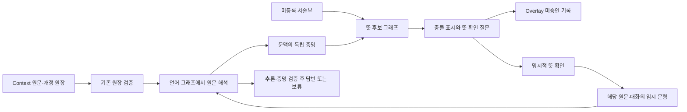
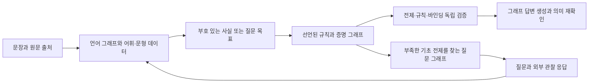
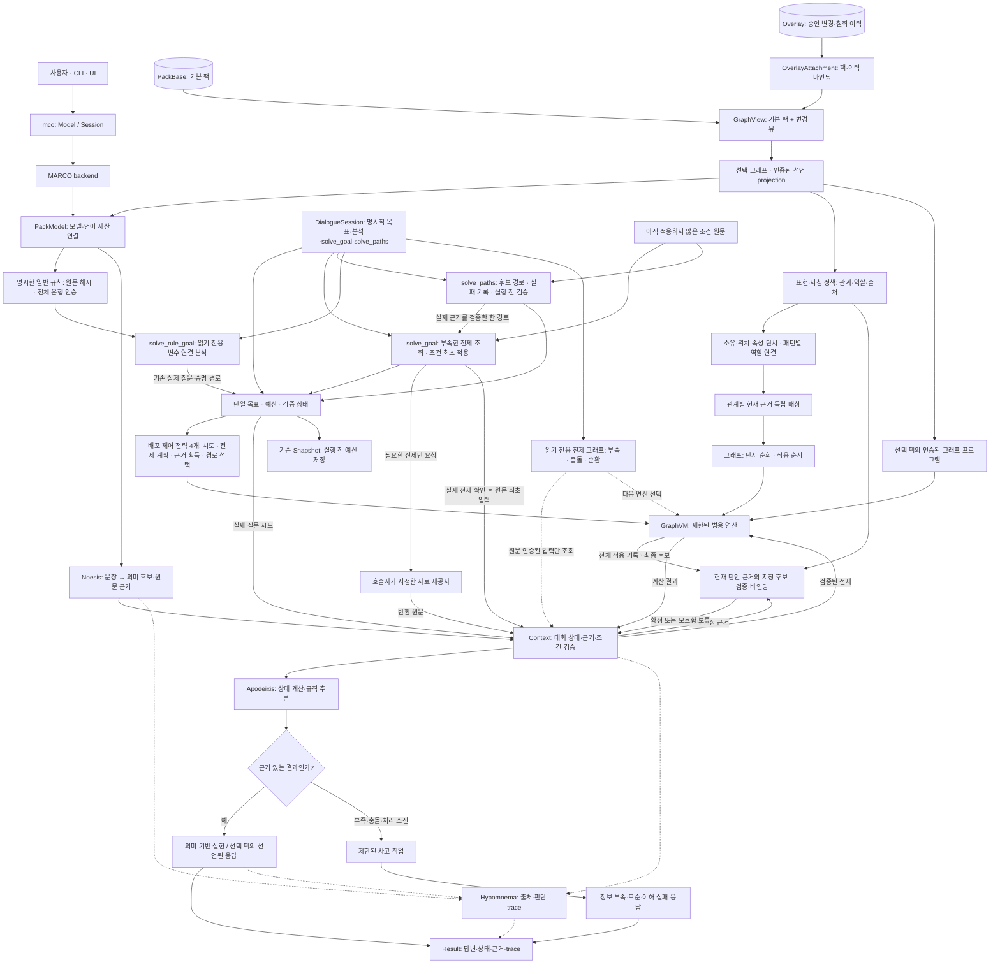
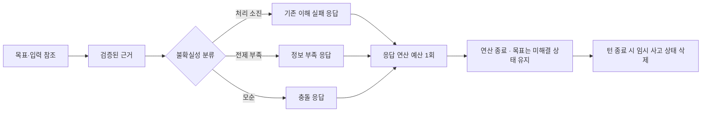
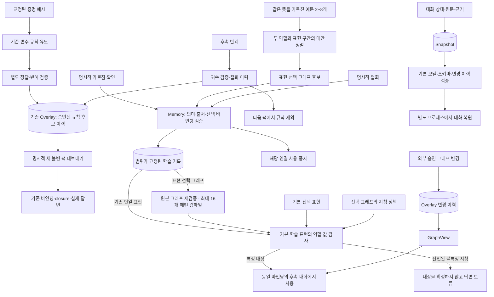

# MARCO 2

MARCO는 지식 그래프, 선언된 언어 규칙, 대화에서 얻은 근거를 사용해 답하는 추론 엔진이다. 입력을 의미 구조로 읽고, 선택한 그래프와 대화 상태에서 조건을 검증한 뒤 답하거나 판단을 보류한다. 현재 언어 처리·추론 경로에 토큰 생성 언어 모델을 호출하지 않는다.

**개발 중 · 현재 구조와 검증 상태: 2026-10-23.** MARCO 1 출시 준비는 취소됐다. 아래 결과는 로컬 개발 본체에 반영한 제한된 기능의 검증이며, MARCO 2 전체 완성이나 일반적인 문장 이해를 뜻하지 않는다.

## 그래프 학습 실험 상태 — 2026-11-05

실험 후보는 기본 실행 경로와 분리한다. 최신 값 내부 구조·경계 학습 실험은 같은 공개 240문장과 기존의 약한 역할 정렬을 사용했다. 완전히 비지도인 의미 학습으로 보지는 않는다. Python 실행부와 Graph VM은 고정하고 학습 그래프만 바꿨다.

학습에서 제외한 값 20개 중 16개는 구성요소를 재조합해 지원했고, 4개는 미확인으로 남았다. 이는 값 구조 검사이며 문장 이해 정답률과 구분한다. 별도로 고정한 새 문장 24개의 첫 결과는 다음과 같다.

| 판정 | 이전 후보 | 새 후보 |
| --- | ---: | ---: |
| 확정 정답 | 18/24 | 8/24 |
| 확정 보류 | 2/24 | 16/24 |
| 추정 정답 | 18/24 | 18/24 |
| 추정 모호 | 3/24 | 3/24 |
| 추정 오답 | 1/24 | 1/24 |
| 추정 보류 | 2/24 | 2/24 |

확정과 추정은 별도 판정이다. 추정 성능은 오르지 않았고 기존 정답 10개가 확정 단계에서 보류로 바뀌어 **새 후보는 채택하지 않았다**. 모호한 사례에는 학습하지 못한 값 배치가, 오답 사례에는 학습 그래프에 없는 문장 구조가 남았다. 이 결과를 이전에 닫힌 평가 점수와 합산하지 않는다. 비교의 이전 후보 탐색 정책은 과거 실행과 바이트 단위로 같지 않으며, 이번 결과로 속도 향상을 주장하지 않는다.

실험 원본·평가 기록·생성 모델은 로컬 보존하고 저장소에는 올리지 않는다. 이 브랜치의 소스 보존은 main 반영이나 실험 후보의 기본 채택을 뜻하지 않는다. 아래 2026-10-23 설명은 당시 연결 경로의 검증 기록이다.

## 모르는 표현을 확인해 사용하는 그래프 — marco2 실험, 2026-10-23

기존 Context의 원문·개정 원장을 읽고, 166노드 그래프가 미등록 서술부의 뜻 후보를 만든다. 기존 세 관계의 긍정·부정 여섯 해석을 모두 남기며, 선언된 문맥과 충돌하는 해석을 표시해 질문 순서에 반영한다. 문맥에 같이 나왔다는 이유만으로 동의어를 확정하지 않는다.

실제로 발급한 질문에 전체 뜻 확인 문장으로 답해야 사용할 수 있다. 확인한 뜻은 그 원문과 대화에만 묶고, 원문 그대로 기존 언어 그래프와 독립 증명 경로에 넣는다. Overlay에는 질문·확인을 **미승인 후보**로만 저장하며 영구 지식으로 채택하지 않는다.



최종 연결부를 고정하고 별도로 만든 문맥 시험에서 다음을 확인했다.

| 새 문맥 대화 비교 | 이전 경로 | 뜻 확인 연결 |
| --- | --- | --- |
| 미등록 표현의 뜻을 확인한 뒤 실제 목표 풀이 | 0/4 | **4/4** |
| 같은 확인 정보를 미리 준 기존 경로 | **4/4** | **4/4** |
| 새 기존 문형 대조 | 4/4 | 4/4 |

따라서 이번 향상은 **문맥 근거와 질문을 통한 뜻 확인의 연결 효과**다. 같은 정보를 가진 추론핵 자체의 정확도 향상을 증명한 것은 아니다. 주 풀이 4건 모두 원문이 실제 선택된 증명의 조상 근거임을 확인했다. 문맥 단서를 쓰는 질문의 후보 여섯 개 유지·충돌 순서는 8/8 일치했고, 문맥에 이미 있는 사실의 별도 대조도 8/8이었다.

원래 12대화 중 평가기가 ‘답하지 않기’ 문항 한 건에 답을 잘못 넣었다. 그 실행·원점수는 보존하고 무효로 분리했으며 **유효 11/11**(풀이4·안전3·기존문형4)만 채택했다. 수선한 평가 절차의 별도 새 미응답 대화 2개는 2/2 보류를 지켰고, 이 두 점수를 원래 무효 문항의 대체 점수로 합치지 않았다. 새 8개 미등록 진술은 공개 검사 문장과 전체 문자열이 겹치지 않는다. 질문과 문맥의 기존 문형은 seed를 공유하므로 모든 문자열이 새롭다는 주장은 하지 않는다.

최종 공개 연결 검사 7묶음과 새 세 과정 저장·복원을 통과했다. 그래프 검사 8/8은 같은 166노드 자산의 기록이며 다시 실행하지 않았다. 초기 연결부의 별도 새 20문제 결과(풀이0/8→8/8, 같은 정보 기존8/8, 안전8/8·기존문형4/4)도 보존하며 최종 후보 점수와 합산하지 않는다. 그 뒤 문맥 준비 단계의 native snapshot 오류가 드러나 연결부만 수선했다.

기존 Context는 일부 실험 문형을 읽기 불가로 기록한다. 이 상태를 지우거나 기존 분석기의 보호를 완화하지 않았다. 기존 원장 검증 함수로 원문·ID·개정을 확인한 다음, **선택한 새 그래프의 해석**으로만 별도 검증한다. 기본 Session이나 기존 문법이 그 뜻을 이해하게 된 것은 아니다. 읽기 불가 문맥의 전체 native 저장 복원도 입증하지 않았다.

연결 API는 `marco.runtime.contextual_meaning_host.advance_contextual_meaning`이다. 등록된 이름 네 개·기존 관계 세 개의 단순 진술 범위이며, 미지 명사·새 관계·미등록 질문·임의 조건문의 뜻을 스스로 발견하는 기능은 아니다. 런타임 LLM·임베딩·자가학습은 없고 기본 프로그램·main 승인 V77은 유지한다. Claude CLI 로그아웃에 따라 사전 승인된 Luna 대체로 구현하고 별도로 감사했다.

## 학습한 문장 조각의 재조합 — marco2 실험, 2026-10-23

통문장 대조에 더해, 기존 의미 seed를 기준으로 조사·어순 조각을 조합하는 선택 경로를 추가했다. 공개 인공 문장 32개에서 `은 /이 `와 목적어 표지, 주어-목적어·목적어-주어 배치를 얻었다. 서로 다른 원문과 대상 쌍에서 반복된 근거만 사용한다. 컴파일러는 학습 원문·seed·근거를 다시 대조하고, 81노드 그래프의 네 데이터 셀만 채운다. 기존 Python 호스트·VM·추론기·모델의 의미 표는 그대로이며 학습 문장에서 사실은 추가하지 않는다.

Sonnet이 후보 코드를 보기 전에 작성한 새 대화 24개를 같은 사실·규칙·목표로 비교했다.

| 실제 문장 비교 | 기존 | 조각 그래프 |
| --- | --- | --- |
| 학습 문장과 겹치지 않는 조사·어순 조합 | 2/8 | **8/8** |
| 학습 근거가 없는 동의 표현·지칭·조건 등 별도 탐색 | 0/8 | 0/8 |
| 부정·인용·정보 부족 등에서 근거 없는 확정 방지 | 8/8 | 8/8 |

오확정·실행 오류는 양쪽 0이다. 주 비교 8개의 전체 문장과 질문은 학습 자료에 없다. 나머지 탐색·보류 범주 16개 중 4개에는 학습 자료와 같은 문자열 5개(질문 3개 포함)가 있어, 24개 모두 완전히 새로운 표현이라고 주장하지 않는다. 앞선 별도 시험의 4/12와는 다른 문항이며 그 점수를 덮어쓰지 않는다. 답변은 Sonnet이 작성한 기준에 따라 독립적으로 로컬 최초 채점했고, 비공개 답변을 외부 모델로 보내지 않았다.

새 코드 검사 첫 36/36, 실제 원문·증명·별도 과정 저장 복원 등 15검사와 새 실행 예제 2/2를 확인했다. 복원 첫 시도의 검사기가 기존 근거의 필드 이름을 잘못 읽은 실패는 보존했으며, 제품을 바꾸지 않고 검사기만 고쳐 해당 단계와 미실행 검사를 마쳤다. 기존에 통과한 검사는 반복하지 않았다.

```bash
python3 tools/graph_compositional_demo.py --non-interactive
python3 tools/graph_compositional_demo.py --ask
```

질문에 `지도를 서준이 가지고 있다.`처럼 학습된 조각을 조합한 전체 문장으로 답할 수 있다. 실행 예제는 고정된 실험 그래프를 사용하며 스스로 학습하거나 파일을 수정하지 않는다. 학습 원문은 `examples/graph_native/composition-training.json`, 근거 그래프는 `language_graphs/ko/foundation-compositional-syntax.json`에 있다. 실제 해석·검증·답변에는 LLM·임베딩을 호출하지 않는다.

**이는 기존 의미에 접지한 제한된 구문 일반화다.** seed가 제공한 역할·서술어 뜻을 무라벨 문장에서 새로 발견한 것은 아니다. 임의의 웹 문장에서 반복된 구간에는 부정이나 다른 의미가 섞일 수 있으므로, 이 학습기를 일반 원문 자동 채택에 사용하지 않는다. 자가학습·기본 Session/main 승인 V77·기본 프로그램 선택은 유지한다. commit/push는 하지 않았다.

## 그래프 기반 문장·추론 실험 경로 — marco2, 2026-10-23

등록한 어휘와 문장 틀을 그래프가 해석하고, 실제 전제·규칙·바인딩으로 증명을 확인한 뒤 그래프가 답변을 만든다. 정보가 부족하면 같은 목표를 유지하며 규칙의 기초 전제까지 내려가 질문한다. Python에는 한국어 문법이나 관계별 추론 분기를 추가하지 않았다. 실행·매칭·검증을 기존 계산 기반에 연결한 선택적 경로다. **런타임 LLM·임베딩·자가학습은 사용하지 않는다.** 기본 Session/main 승인 V77은 그대로다.



| 새 공개 검증 | 실제 결과 | 구분 |
| --- | --- | --- |
| 새로운 어휘·문형 조합의 완전 정보 문장 | 풀이 12/12, 보류 6/6 | 등록된 문형의 조합 일반화 |
| 중간 조건 대신 기초 전제를 물어 해결 | 기존 0/6 → 새 6/6, 보류 양쪽 2/2 | 같은 추가 정보를 준 기존 추론기도 6/6: 정보 획득 개선 |
| 동일 정보·한도에서 확보한 유한 증명 활용 | 기존 엄격한 방식 0/4 → 새 4/4, 보류 양쪽 4/4 | 전체 탐색 중단과 개별 증명의 완성을 분리 |

모든 비교의 오확정과 실행 오류는 0이다. 별도의 의미 구조 상한 비교는 16/16·보류 2/2이며 문장 평가와 분모가 달라 합산하지 않는다. 첫 후속 대화 4개는 중간 질문에 대한 평가 환경 응답이 없어 실행 오류였고, 원본을 보존한 뒤 **새 문제**로 비교했다. 첫 순환 사례 실패와 검사 전제 오류도 별도로 남겼다. 이 결과는 일반 한국어 이해나 자가학습 준비 완료를 뜻하지 않는다.

직접 실행:

```bash
python3 tools/graph_native_dialogue.py --non-interactive --proof
python3 tools/graph_native_dialogue.py --ask
```

예제는 `examples/graph_native/ko-understanding.json`의 명시적인 가상 규칙을 따른다. 두 번째 명령에서는 질문을 받은 뒤 `서준은 지도를 가지고 있다.` 같은 등록된 전체 문장으로 답한다. 문형·어휘·관계를 바꿀 때는 예제의 그래프 데이터를 바꾸며, Python 문법 분기는 추가하지 않는다. `--case`로 다른 예제를 선택할 수 있다.

현재 한 언어 모델 데이터는 어휘 표기 8개·문형 12개 이내인 두 명칭 슬롯의 제어 언어다. 미등록 표현·복수 해석은 보류하고, 부정·충돌을 긍정 사실로 바꾸지 않는다. 질문·가설도 사실이 아니다. 자기학습·지식 자동 채택은 꺼두었고, 원문·실행 기록·증명과 거절 이유를 확인하는 경로까지 연결했다. 외부 보고의 출처 해시·호출자 확인은 현실의 진실이나 발신자 신원을 인증하지 않는다.

## 서로 다른 문맥 단서의 그래프 조합 — V77

선택 그래프에 색상 속성 문장, 대상 이름 질문과 소유·위치·속성의 단서 패턴을 선언했다. 관계별 현재 긍정·단언 근거를 독립적으로 매칭하고, 기존 `reference-clauses` 그래프 프로그램이 모든 단서의 교집합과 중간 후보를 계산한다. 공통 VM과 프로그램은 그대로다. Python은 원문·역할·출처 검증, 공통 매칭과 실제 답변 바인딩을 맡으며 관계별 뜻을 분기로 추가하지 않는다.

최종 소스·평가기를 고정한 뒤 작성한 새 16대화·첫 답변 32개의 독립 비교에서, 실제 대상 이름 정답은 **0/8→8/8**(gain8/loss0)이었다. 소유·속성 두 단서의 2개 순서와 소유·위치·속성 세 단서의 6개 순서를 포함한다. 세 단서는 하나나 어느 두 개만으로도 후보가 여러 개이며 모두 사용해야 정답이 정해진다. 후보 없음·여럿·부정 소유 근거·다른 대화 근거를 실제로 구분한 결과는 **0/8→8/8**, 근거 없는 답을 피한 결과는 양쪽 8/8이다. 새 버전의 전체 VM 적용·중간 후보는 16/16 일치했다. V76·기존 팩과 최종 V77·새 지식·질문·정책·연결의 결합 효과이며, 선언한 표현 틀의 새 대상·관계 조합 범위다.

공개 211검사·38입력에서 실제 속성 사실 인증, 세 단서 각각을 뺀 질문의 모호함, 부정 근거 제외, 별도 과정 저장 복원과 기존 경로를 확인했다. 추가 소스 감사에서 단서 없는 새 지칭 질문의 내부 슬롯 출력 경로를 수선했고 별도 공개 15검사·5입력을 통과했다. 수선 전 첫 후보의 16대화·최초 점수는 별도로 보존하고 최종 후보에는 완전히 새 16대화를 사용했다. 조립 그래프는 444노드·983연결이며 실제 컴파일도 기존 512·1,024 한도 검사를 통과했다. 순수 보조 구조만 오프라인에서 공유하고 기존 역할·의미·규칙과 원문 팩 자산을 보존했다.

`models/MARCO2-Korean-Contextual-Reference-Heterogeneous.kgpack`을 명시적으로 선택한다. 기존 팩·기본 선택·VM·조건 프로그램은 유지한다. 임의의 새 표현 전반, 경험에서의 속성 규칙 발견, 일반 지능과 10배 그래프 학습은 이번 결과로 입증하지 않았다.

## 여러 문맥 단서의 그래프 실행 — V76

단서별 근거를 독립적으로 매칭한 뒤, 선택 팩의 그래프 프로그램이 단서 순회와 교집합 적용 순서를 실행한다. Python은 범용 `intersect` 연산, 원문·출처 인증, 결과 검증을 맡는다. 단서 수를 두세 개로 고정하지 않으며 기존 자료·연산 예산을 넘으면 계산 보류를 반환한다. 남은 단서를 모두 적용하기 전에 대상을 확정하지 않는다.

같은 사실·질문을 받은 새 대화 16개·첫 답변 32개의 독립 비교에서, 두세 소유 단서로 대상을 골라 위치를 답한 실제 정답은 **0/8→8/8**, gain8/loss0였다. 두 단서 순서 2개와 세 단서 순서 6개를 모두 포함했고, 세 단서 문항은 어느 두 단서만으로도 답이 정해지지 않는다. 후보 없음·복수·부정·다른 대화 근거의 실제 구분은 **0/8→8/8**, 근거 없는 답을 피한 결과는 8/8→8/8였다. VM의 전체 적용 순서·중간 후보는 새 버전 16/16 일치했다. 선언된 소유·위치 표현 틀의 새 대상·조합 비교이며, V75·기존 팩과 V76·새 팩의 결합 효과다.

수선본 공개 검증 187개·35입력에서 네 단서 반복, 실제 부정 근거, 별도 과정 복원과 기본 예산 소진 시 보류를 확인했다. 첫 공개 실행의 출력 경로 변수 오류·0입력 실패를 보존하고 승인된 수선 실행 한 번만 진행했다. 선택 언어 그래프는 462노드·1,023연결이며 기존 512·1,024 한도를 유지한다. 기존 AND·조건 프로그램의 원문·의미와 기존 팩을 보존하고, 새 팩은 원래 조건 프로그램과 지칭 프로그램을 인증된 묶음으로 참조한다. `models/MARCO2-Korean-Contextual-Reference-Multiclue.kgpack`을 명시적으로 선택한다. 기본 팩 선택과 일반·역사 시험 점수는 유지한다.

## 문맥 단서로 지칭 후보 좁히기 — V75

선택 그래프의 단서 패턴과 역할 연결을 사용해 여러 지칭 후보 중 실제 단서와 맞는 대상만 남긴다. 현재는 위치 단서 하나로 소유자를 골라 그 사람의 소유물을 답하는 긍정 이항 관계 범위다. 두 역할의 연결은 해당 단서 패턴 안에만 선언하며 전역 역할을 합치지 않는다. Python은 기존 원문·출처 검증과 공통 매칭·후보 교집합·답변 연결을 맡는다. 단서 없는 기존 지칭 질문도 유지한다.

같은 사실·질문을 받은 새 대화 16개·최초 32답 독립 비교에서, 단서로 대상을 고른 뒤 실제 답을 맞힌 결과는 **0/8→8/8**(gain8/loss0)이었다. 반대 역할·관련 없는 대상·명시적 `Context.correct` 이후 현재 근거도 포함한다. 대상 없음·여럿·부정 단서·다른 대화 근거를 구분한 결과는 **0/8→8/8**, 근거 없는 답을 피한 결과는 양쪽 8/8이었다. 교정은 자연어 이해 평가가 아니며, 선언된 위치 단서 틀에 새 대상·대화를 조합한 결과다. 비교는 V74·기존 팩과 V75·새 단서 팩의 결합 효과다.

공개 최초 151검사·26입력과 저장 후 별도 과정 첫 복원을 통과했다. 기존 그래프 노드·연결·다른 팩 자산을 보존했으며 선택 언어 그래프는 454노드·1,007연결로 기존 한도 안에 있다. `models/MARCO2-Korean-Contextual-Reference-Clue.kgpack`을 명시적으로 선택한다. V75 당시 여러 단서의 조합은 평가하지 않았다. 자유로운 관계절 표현과 일반적인 문맥 추론은 계속 미입증이다.

## 기초 표현 그래프와 문맥 지칭 연결 — V73·V74

공개 문장 300개에서 어휘·표현의 빈틈을 확인하고, 문장 전체 대신 합성 가능한 표현 틀 12개와 수식어 4개를 그래프에 추가했다. V73의 학습하지 않은 새 조합 비교에서 의미 이해는 **6/12→12/12**였다. 모호한 표현 4개는 양쪽 모두 근거 없는 답을 피했지만, 실제 모호함 구분은 1/4로 같았다. 자유 문장만으로 하는 비지도 언어 학습의 증거는 아니다.

V74는 기존 Context의 현재 긍정·단언 근거를 선택 그래프에 선언한 지칭 표현·관계·역할과 연결한다. Python은 출처 검증·후보 바인딩과 기존 답변 경로를 맡는다. 지칭 질문을 사실로 저장하거나 최근 대상 하나를 임의로 선택하지 않는다. `models/MARCO2-Korean-Contextual-Reference-Resolution.kgpack`을 명시적으로 선택하며 기존 팩과 기본 선택은 유지한다.

새 대화 16개·두 버전 첫 답변 32개의 독립 판정에서, 대상이 확정되는 8개의 실제 정답·근거 있는 지칭 해석은 각각 **0/8→8/8**이었다. 대상 없음·여럿·새 대화·부정 근거의 8개에서 실제 상태 구분은 **0/8→8/8**, 근거 없는 답을 피한 것은 양쪽 8/8이다. 이는 두 개의 선언된 지칭 질문 틀에 새 대상·대화를 조합한 결과이며 임의의 새로운 대명사·표현 전반의 일반화 점수가 아니다. 비교는 V73 원본·기존 팩과 V74·새 지칭 정책 팩 사이의 결합 효과이며, 같은 팩에서 엔진만 바꾼 비교는 아니다. 두 교정 사례는 기존 `Context.correct` 호출을 사용했고 자연어 교정 이해나 그 교정의 저장 복원을 평가하지 않았다.

공개 문장·출처·별도 과정 복원 검증 164개와 16입력을 통과했다. 같은 묶음의 마지막 파일 보호 검사는 없는 시험 파일 때문에 실패한 원기록을 보존하며 전체 성공으로 바꾸지 않았다. 이후 실제 존재하는 소유 시험 파일만 사용하는 별도 보호 검사를 통과했다. 실제 Opus·Sonnet 병렬 구현과 소스·첫 답변·종료·바이트 독립 감사를 거쳤으며, 닫힌 문항의 재실행·재채점은 하지 않았다. 학습 철회와 모든 Overlay/GraphView 수명주기의 지칭 정확도, 일반 지능과 10배 그래프 확장은 미입증이다.

## 예시 규칙의 검증·저장·철회 — V72

결론을 교정한 증명 예시에서 기존 `rules.induce/propose`가 변수 규칙 후보를 만든다. 별도의 긍정·부정 예시를 통과하면 `LearningMemory.teach_rule_experiences()`가 기존 Memory/Overlay에 저장하고, `write_rule_revision()`이 명시적으로 선택할 새 불변 팩으로 내보낸다. 후속 반례를 `refute_rule()`로 확인하면 다음에 내보내는 팩에서 해당 규칙을 제외한다. 이미 고정한 이전 팩·대화는 유지한다. 후보를 현재 해석기에 바로 설치하지 않는다.

같은 교정 예시 2개·검증 예시 4개를 받은 **이전 학습기+외부 수동 팩 조립**, **새 경로**, **사람이 규칙을 직접 준 비교군**에 같은 새 8문제를 제공했다. 최초 24답 독립 판정에서 모두 **응답 정확성 8/8**, 근거 있는 지원 목표 완료 5/5, 정직한 비함의 보류 3/3이었다. 학습하지 않은 대상의 한 단계 전이 2/2와 같은 규칙의 두 단계 연결 2/2도 세 경로 모두 통과했다. gain0/loss0이며 추론 정확도 상승은 없었다. 기존 학습기도 같은 가설을 만들 수 있었고, 이번 변경은 검증·저장·내보내기·철회의 연결을 자동화한다.

공개 최초 8그룹·9개 별도 과정의 58검사를 통과했다. 승인 전 후보의 비활성, 출처·이력 변조 거절, 저장 후 별도 과정 복원, 반례 철회와 같은 반례를 잊은 재채택 차단을 확인했다. 학습 규칙은 긍정 이항 관계·활성 후보 한 개의 유한한 교사 지도 범위다. 새 유도 알고리즘, 자유 문장만으로 하는 비지도 규칙 발견, 일반 지능 향상은 입증하지 않았다. Context·공통 VM·기존 팩·기본 모델 선택은 유지한다.

## 선택 팩의 변수 규칙 연결 — V71

명시적으로 선택하는 `models/MARCO2-Experimental-Variable-Rules.kgpack`에 일반 변수 규칙 3개를 선언했다. 기존 변수 바인딩·closure·증명 엔진을 그대로 사용한다. `PackModel.authenticated_rule_view()`는 규칙 원문의 해시와 전체 규칙 은행을 확인하며, `analyze_rule_goal(text)`는 현재 근거의 변수 연결을 읽기 전용으로 설명한다. `solve_rule_goal(text)`는 이 경계를 확인한 뒤 기존 `start_goal`의 실제 질문·증명·예산 저장 경로로 위임한다. 분석 결과를 사실로 넣지 않는다. 긍정 이항 관계, 규칙 3개·전제 각 2개·증명 깊이 2의 제한된 범위다.

학습하지 않은 새 대상·관계 조합 8문제에 이전·새 버전 모두 같은 규칙 팩과 사실을 주었다. 독립 첫 판정은 **응답 정확성 8/8→8/8**, 답할 수 있는 문제의 실제 증명 완료 5/5→5/5, 정보 부족·잘못된 변수 연결의 정직한 보류 3/3→3/3이었다. gain0/loss0이며 추론 정확도 향상은 없었다. 기존 엔진에도 변수 일반화 능력이 있었고, 이번 변경은 명시적 규칙의 인증·분석 연결을 제공한다. 별도 의미 구조 진단은 양쪽 8/8, 새 인증 분석은 8/8이다. 이전 버전의 새 분석 API 부재는 N/A로 처리했다.

첫 팩 조립·인증 7검사와 새 실행·변조 거절·별도 과정 복원 19검사를 통과했다. 첫 답변 16개를 봉인해 한 번씩 채점했으며 닫힌 시험은 반복하지 않았다. 평가 CPU 합산은 61.954748초→77.954963초로 추가 분석 비용을 포함한다. 이 팩의 소유·위치 규칙은 **명시한 실험용 가정**이며 경험에서 학습한 현실 규칙이 아니다. 기본 팩 선택·Context·공통 VM·기존 팩은 유지한다. 새 규칙 발견·수정·철회 학습과 일반 지능 향상은 아직 입증하지 않았다.

## 여러 추론 경로의 검증·선택 — V70

`DialogueSession.solve_paths(text, *, rule_sources)`는 하나의 질문과 처음부터 제공한 사실·조건 원문에서 후보 경로를 만들고, 실행 전 검증에 실패하면 다음 경로를 고른다. 같은 결론에 도달하는 서로 다른 조건을 대안으로 다루며, 결론 자체가 여러 개면 모호함을 유지한다. GraphVM의 새 배포 제어 전략이 경로 검증·실행·정지를 선택하고, 실제 원문 적용과 답변 증명은 기존 `solve_goal`과 Context 경로에 위임한다. 별도 추론 엔진이나 사실 저장소를 만들지 않는다.

범위는 긍정 이항 사실·긍정 AND 조건 원문 최대3개, 후보 경로3개, 경로당 규칙2개·전제각2개·깊이2다. 실제 근거가 모든 말단 전제를 뒷받침하는 경로만 선택하며 다른 후보의 예상 결론을 빌려 쓰지 않는다. 실패·근거·소모 예산을 기존 Snapshot에 저장한다. 검증은 최대3회, 실제 풀이 위임은 최대1회다. 실제 실행을 시작한 뒤 실패하면 부분 변경을 보존하고 종료하며 다른 경로를 덧실행하지 않는다. 중단·손상 상태와 같은 실패 질문은 예산을 초기화해 재실행하지 못한다.

새8문제에 양쪽 모두 같은 사실과 규칙을 처음부터 전부 제공했다. 자동 과업 완료는 이전2/8→새6/8(gain4/loss0)이었다. 첫 경로 전제 부족3문제와 순환1문제를 다른 경로로 해결했고, 이미 답이 있던2문제는 유지했다. 모든 경로가 막힌2문제는 실제 질문 없이 `response=None`으로 안전 종료했다. 이 종료를 답변 정답으로 세지 않는다. 같은 정보를 받은 이전 엔진의 강한 외부 수동 경로 선택도6/8로서, 개선은 대안 경로 선택의 자동화다. 추론핵 자체의 정확도 향상이나 일반 지능 향상을 입증한 결과는 아니다.

별도 독립 의도 의미 구조를 기존 closure에 준 진단은 양쪽8/8이며, 문장의 초기 사실·질문·규칙 해석도 해당 의도와각8/8 일치했다. 이 진단은 Session의 시간순 실행 권한이나 일반 문장 이해의 증명이 아니다. 실제 질문 응답22개 원본과 별도 API 종료2개를 보존하고, 고유20개 최초 판정을 봉인한 뒤24개 결과 항목에 연결했다. 새 버전의 실제 최종 답변6개는 모두 근거 있는 정답이었다. 이전 버전의 정직한 보류를 오답 주장으로 바꾸지 않으며, 고정 집계의 `native_response_correct`는 근거 있는 답변까지 요구하는 별도 지표다. API 종료 형태 때문에 완전한 버전 은폐에는 한계가 있다.

공개 최초12/12(39검사·13별도 과정), 새 세 번째 원문 실행 경계1/1(6검사)을 통과했고 닫힌 시험은 반복하지 않았다. 평가 합산 CPU94.644829초→173.127004초는 새 경로 검증과 답변 검증 증가를 포함하므로 동일 계산량의 속도 비교가 아니다. Context·공통 VM·선택 팩·메모리 책임·SDK/UI 기본 선택은 유지한다. 학습·그래프 확대·push는 이번 범위에 포함하지 않는다.

## 전제 획득·풀이 연결 — V69

`DialogueSession.solve_goal(text, provider, *, provider_id, rule_sources)`는 아직 적용하지 않은 조건 원문에서 하위 전제를 찾고, 명시적으로 제공한 자료 제공자에게 부족한 근거를 조회한다. 받은 원문은 기존 대화 경로에서 검증·저장하고, 전제가 실제 충족된 조건만 처음 한 번 적용한 뒤 원래 질문에 다시 답한다. 예상 결론을 사실로 넣거나 과거 조건문을 다시 실행하지 않는다. GraphVM의 새 배포 제어 전략이 조회·입력·조건 적용·질문·검증을 선택한다.

범위는 긍정 이항 관계, 최대 두 개의 조건 지시, 조건별 전제 두 개와 깊이 두 단계다. 자료 조회·입력·조건 적용·원래 질문·검증은 각각 최대 두 번이다. 실행 전에 예산을 저장하고, 중단된 동작은 복원 후 반복하지 않는다. 같은 인증된 질문·제공자·조건 원문·바인딩의 실패 작업은 표기가 달라도 예산을 초기화하지 못한다. 관련 정보가 추가되어도 같은 실패 요청을 다시 시작하지 않는 보수적 제한이 있다. 제공자는 호출자가 신뢰하는 사실 자료의 경계이며, 원문의 의미 인증이 현실의 참을 증명하지는 않는다.

새 8문제의 실제 첫 답변을 비교했다. 초기 정보만으로 완료한 문제는 2/8, 새 자동 경로는 6/8이었다. 한 근거 획득 2/2와 두 근거·두 규칙 연결 2/2를 완료했고, 미존재·부적격 근거 2문제는 보류했다. 같은 정보·조회 순서·최종 상태를 제공한 이전 버전의 강한 외부 수동 지원도 6/8이었다. 정직한 보류를 포함한 응답 정확성은 세 경로 모두 8/8이며, 동일 정보 추론 정확도의 gain0/loss0다. 개선은 정보 획득과 풀이 진행의 자동화이며 추론 자체의 정확도 향상을 주장하지 않는다.

별도 현재 사실·의미 구조 closure 진단은 이전·후보 각각 초기/최종 모두8/8, 새 전제 계획의 목표 범위도 초기/최종8/8이었다. 이 진단은 인증된 Session 실행이나 과거 조건의 시간순 진실 판정이 아니다. 실제 질문 원본24개를 보존하고, 고유 판정 대상20개를 버전을 가려 최초 봉인한 뒤24개 결과 항목에 연결했다. 공개 기능13/13(34검사)와 이후 강화한 질문 동치 재시작 차단의 새 공개1/1(5검사)을 확인했으며 닫힌 시험은 반복하지 않았다. 전체 평가 합산 CPU는63.476482초→185.760376초였다. 후보의 추가 계획·원문 검증·저장과 답변 검증6회를 포함하므로 같은 계산량의 속도 비교는 아니며 처리 비용 증가를 보존한다. 일반 문장 이해·자율 목표 선택·규칙 학습·전체 M2의 증거는 아니다. Context·VM·선택 팩·SDK/UI 기본 선택·push는 바꾸지 않는다.

## 이전 제한된 목표·전제 계획 — V68

기존 `DialogueSession`에 원래 질문을 유지하는 명시적 목표 API와 읽기 전용 `analyze_goal(text)`를 추가했다. 목표 시도는 총 두 번으로 제한하고, 원래 질문에 맞는 새 긍정 근거가 실제 채택된 뒤에만 재시도한다. 실행 전에 예산을 저장하며 중단된 시도는 복원 후 자동 반복하지 않는다.

분석기는 인증된 대화 원문에서 최대 두 개의 긍정 조건 규칙을 읽고, 최대 두 단계의 하위 전제를 그래프로 표시한다. 부족·반박·충돌·순환·처리 한도를 구분하고 기존 GraphVM의 배포 전략이 다음 시도·근거 대기·정지를 선택한다. 이 계획은 읽기 전용이다. 예상 결론을 실제 사실로 저장하거나 그 자체를 정답으로 반환하지 않는다. 실제 답은 기존 대화·원문 증명 경로가 맡는다. 명시적 의미 구조 입력은 별도 진단이며 인증된 대화 실행과 같다고 주장하지 않는다.

공개 기능 최초12/12를 통과했다. 같은 공개 입력·질문·정답 검증을 사용한 새 CPU 비교는 44.919428초→39.256030초(12.6079% 감소), snapshot 호출은 상황별6→5·10→8이었다. 유한 1회 관측이며 통계적 속도 보장은 아니다. 새 문장 최초8문항은 이전·후보 모두8/8(gain0/loss0), 별도 명시적 의미 구조 closure도 양쪽8/8이었다. 새 전제 계획기8/8·인증된 대화 분석8/8을 확인했지만 이전 버전에는 해당 API가 없어 기능 비교는 N/A다. 정확도 향상을 입증한 결과는 아니다. 전체 새 진단 작업의 합산 CPU는89.971670초→114.231499초로 증가했다. 후보에 추가된 분석8회·계획16회를 포함하므로 앞의 동일 목표 경로 개선과 구분하며 전반적 속도 향상은 주장하지 않는다. V67의 원계획10 중9쌍 최초 비교8/9→9/9와 마지막1개 CPU90 제한 미평가·실패는 별도 보존한다. 자발적 사고, 일반적인 목표 분해·문장 이해, 새 지식 학습이나 전체 M2 완성의 증거는 아니다. Context·VM·선택 팩·SDK/UI 기본 선택과 push는 변경하지 않는다.

## 전체 구조

실행 진입점은 `mco`, 모델과 언어 자산의 실행 연결은 `PackModel`, 대화의 의미 판단은 `Context`가 맡는다. 선택 그래프의 선언과 출처가 의미 해석의 기준이다.



| 책임 | 실제 위치 | 경계 |
| --- | --- | --- |
| 공개 API·세션 | [`mco/`](mco/model.py) | 모델 로드, 독립 대화, 결과, 저장·복원 |
| 모델 실행 연결 | [`pack_model.py`](pack_model.py), [`mco/backends/marco.py`](mco/backends/marco.py) | 팩 자산과 실행 상태를 연결 |
| 그래프와 변경 뷰 | [`marco/storage/graph_view.py`](marco/storage/graph_view.py), [`overlay.py`](marco/storage/overlay.py) | 기본 팩, 선택 뷰, 변경·철회 이력. 언어 의미를 자체 판정하지 않음 |
| 문장 이해 | [`relational_semantics.py`](relational_semantics.py), [`marco/language/`](marco/language/frames.py) | 선택 팩의 문법·관계 선언, 절 경계, 의미 후보, 원문 범위와 인증 |
| 대화와 추론 | [`marco/reasoning/`](marco/reasoning/context.py) | 사실·부정·조건·수정의 상태와 근거 검증 |
| 제한된 사고 작업 | [`query_work.py`](marco/reasoning/query_work.py) | 목표·근거·불확실성·연산·예산을 값으로 표현 |
| 그래프 프로그램 실행 | [`graph_vm.py`](marco/reasoning/graph_vm.py) | 인증된 프로그램의 제한된 범용 연산. 사실의 의미·출처를 자체 인증하지 않음 |
| 답변 실현 | [`marco/language/realizer/`](marco/language/realizer/__init__.py) | 의미 기반 조립과 역검증. 선택 경로의 상태 응답은 팩 선언을 사용 |
| 표현 규칙 학습 | [`expression_graph.py`](marco/learning/expression_graph.py) | 동치 예문의 역할·표현 구간 대안으로 그래프 유도. 별도 검증 후 기존 해석기에 컴파일 |
| 학습 메모리 | [`marco/learning/memory.py`](marco/learning/memory.py) | 명시적으로 가르치고 검증한 표현·의미 연결의 저장·사용·철회 |
| 출처와 저장 | [`marco/trace/`](marco/trace/__init__.py), [`marco/storage/snapshot.py`](marco/storage/snapshot.py) | 판단 이력과 대화 상태 저장. trace 자체가 정답의 증명은 아님 |

명시적으로 선택하는 `models/MARCO2-Korean-Contextual-Graph-VM.kgpack`은 인증된 `programs/scoped-and.json`으로 AND 조건의 제어 흐름을 실행한다. GraphVM의 범용 연산은 `scan`, `match`, `set`, `append`, `branch`, `return`, `intersect` 일곱 가지이며, 사실 매칭과 원문·인증서의 권한 검증은 기존 Context 경로가 맡는다. 프로그램 참조가 없는 기존 팩은 기존 경로를 유지하고, 참조가 있는 팩은 잘못된 프로그램의 로드를 거절하며, 프로그램 실행이 실패하면 판단을 보류한다. 새 `models/MARCO2-Korean-Contextual-Logic-Graph-VM.kgpack`은 `programs/scoped-conditions.json`으로 전제의 긍정·부정과 AND·OR 조합을 계산한다. 선언된 전제 한두 개와 긍정 결과 하나를 지원하며, 부정 전제는 명시적 부정 근거로 검증한다. 정보가 없거나 긍정·부정 근거가 충돌하면 미정으로 유지한다. OR에서는 다른 전제의 참이 확인되면 결과를 낼 수 있다. 기존 두 팩과 AND 프로그램은 그대로다. VM의 지역 값은 한 번의 실행에만 존재하며 지식으로 저장되지 않는다.

`engine.py`의 기존 그래프 탐색·판정 경로와 `marco/knowledge`, `marco/perception`, `marco/host`도 존재한다. 이 모듈들의 존재가 일반 지능이나 자발적 사고 루프의 완성을 뜻하지는 않는다.

## 한 번의 사고 작업

실패 응답에는 턴 동안만 쓰는 임시 Thinking Graph가 있고, 명시적 목표 API에는 목표·시도·검증 이력을 기존 Snapshot에 저장하는 별도 작업 그래프가 있다. 아래 그림은 임시 실패 응답 경로다. 입력 처리 소진, 전제 부족, 모순을 구분하고 검증된 근거에 맞는 응답 연산 하나를 실행한다. 일반적인 가설 생성기나 자율 목표 선택기는 아직 붙이지 않았다.



중복 실행이나 예산 초과는 거절한다. 응답 연산이 완료됐다는 이유로 목표가 해결됐거나 가설이 사실이 됐다고 기록하지 않는다. 아래 임시 응답 작업은 대화 스냅샷에 영구 저장하지 않는다. 명시적 목표·풀이 작업의 예산과 이력은 별도 키로 저장하며, 미완료 동작을 복원 후 자동 재실행하지 않는다.

## 학습·변경·복원



Memory, Overlay, Context는 서로 다른 책임을 가진다. 관찰이나 추론 가설을 검증 없이 영구 지식으로 승격하지 않는다. 복원할 때도 원래 선택 팩과 출처의 조건을 확인하며, 다른 그래프로 조용히 대체하지 않는다.

`DialogueSession.teach_patterns`는 같은 역할 순서와 이미 알려진 긍정 관계의 동치 예문에서 표현 구간의 대안을 배운다. 선택 그래프를 기존 Overlay의 학습 기록으로 저장하고, 복원 시 예문에서 다시 유도한 그래프와 대조한 뒤 기존 해석기에 컴파일한다. 별도 양성·음성 예문을 통과해야 채택하며 철회는 그 그래프의 모든 파생 패턴을 제거한다. 관측된 표현 조각의 조합을 다루는 최소 범위이며, 새 단어의 뜻 발견·자율 학습·일반 문법 유도는 검증하지 않았다. 기존 패턴과 겹치면 보수적으로 거절한다. 이 연결은 학습용 `DialogueSession` 경로이며 mco SDK·UI 전체 연결을 검증한 결과가 아니다.

새 `MARCO2-Korean-Contextual-Reference-Graph-VM.kgpack`을 명시적으로 선택하면 인증된 언어 자산의 `references` 정책을 기본·학습 표현의 공통 해석 경로에서 사용한다. 선언된 불특정 지칭과 역할 값 전체가 일치할 때 구체적 개체로 확정하지 않으며, 그 표현이 긴 이름의 일부이면 이름을 그대로 허용한다. 원문 증명 재검증에도 같은 정책을 적용한다. 원래 팩과 정책이 없는 팩의 동작은 보존했다. 이 범위는 선택된 지칭 표현의 안전한 보류이며 일반적인 지시어 해소나 존재 대상의 추론은 다루지 않는다.

## 최근 실제 문장 검증

구조 검사와 실제 답변 평가는 따로 기록한다. 새 문항의 첫 답변을 저장하고, 버전을 가린 독립 판정을 먼저 고정한 뒤 비교했다. 별도로 사용자가 요청한 역사 108문항의 재시험은 한 번만 실행했으며 원래 2/108 기록을 보존했다. 다른 닫힌 시험을 이 작업에서 재실행하거나 재채점하지 않는다.

| 작업 | 이전 → 수정 후 | 검증 범위 |
| --- | --- | --- |
| 예시 규칙 학습 관리 | **8/8 → 8/8** | 같은 예시의 기존 학습기+수동 조립과 새 경로 동률. 사람 규칙도8/8. 지원 완료5/5·정직한 보류3/3; 새 유도 능력이나 정확도 향상은 미입증 |
| 전제 획득·조건 최초 적용 | **초기 완료2/8 → 자동 완료6/8** | 새8문제. 동일 정보의 이전 버전 수동 지원도6/8, 정직한 응답 정확성은 모두8/8. 정보 획득·진행 자동화이며 추론 자체 향상은 미입증 |
| 불확실성 분류·최소 사고 작업 | **8/10 → 10/10** | 새 대화 10개, 버전별 22입력. 조건 전제의 모순 응답 개선 |
| 두 조건의 AND 조합 | **2/10 → 10/10** | 새 대화 10개, 버전별 38입력. 아래 다섯 범주 |
| AND 대화 저장·별도 프로세스 복원 | **1/1 통과** | 별도의 새 대화, 설정 입력 3개와 복원 후 질문 1개 |
| AND의 Graph VM 전환 | **10/10 → 10/10** | 다른 새 대화 10개, 버전별 38입력. 기능 유지; 별도 저장·복원 후 답변도 1/1 |
| 같은 Graph VM의 OR·부정 전제 | **2/12 → 12/12** | 다른 새 문장 12문제, 버전별 45입력. OR 0/6→6/6, 부정 전제 0/4→4/4, 기존 AND 2/2 유지; gain10/loss0 |
| OR·부정 조건 저장·별도 프로세스 복원 | **각 1/1 통과** | 비교 문항과 다른 새 대화 두 개. OR 설정 3입력·부정 조건 설정 2입력 후 각각 복원 질문 1개 |
| 표현 선택 그래프 학습 | **5/8 → 7/8** | 같은 동치 예문 2개를 기존 버전은 각각, 후보는 그래프로 학습. 새 문장 8개·버전별 16입력. 미등장 표현 조합 0/2→2/2, gain2/loss0 |
| 불특정 지칭 공통 처리 | **7/10 → 10/10** | 양쪽에 같은 그래프 표현 학습을 적용한 뒤 새 문장 10개·버전별 20입력. 답변 보류 1/4→4/4, 구체적 정답 4/4 유지, 부정·역할 안전성 2/2 유지; gain3/loss0 |

불특정 지칭 비교의 20개 첫 판정은 버전 공개 전에 봉인했다. 새 문장과 개체 바인딩의 평가이며, 정책에 없던 새 단어 뜻의 발견은 검증하지 않았다. 별도 프로세스 복원 후 구체적 정답·학습 그래프 출처와 불특정 대상의 비확정 응답도 확인했다. 공개 첫 정책 검사의 통과와 검사기의 관계명 비교 오류를 보존했고, 승인한 새 나머지 5개 검사만 실행해 5/5 통과했다. SDK·UI의 기본 선택 변경과 역사 108문항 재실행은 하지 않았다.

표현 그래프 학습의 나머지 범주는 기존 표현 2/2→2/2, 과잉 일반화·역할 역전 2/2→2/2, 부정·불명확 1/2→1/2다. 전체 8문항 통과가 아니며, 공통으로 실패한 불명확 입력 한 개의 답변·질의·근거는 양쪽에서 같았다. 최초 16개 판정을 버전 공개 전에 봉인했다. 공개 검사 앞선 7개와 별도 프로세스 복구·출처·철회 2개를 구분해 보존한다. 최초 공개 검증기의 근거 누락 오류 및 최초 비교 실행기의 보조 모듈 탐색 실패는 그대로 기록했고, 각각 승인한 남은 검사와 실행기 수선 재시작만 수행했다. 새 단어의 뜻 발견이나 모호성 해결, 일반 이해력의 증명이 아니다.

Graph VM 전환의 첫 비교는 이전 버전 10개 정답, 후보 9개 정답·1개 미실행이었다. 후보가 계측 중 CPU 180초 한도에 걸린 기록을 보존하고, 별도 새 문항을 동일한 CPU 240초·전체 360초 한도로 두 버전에 처음 실행해 위 결과를 얻었다. 완료된 첫 9쌍과 새 10쌍 모두 gain0/loss0이며, 지능 향상이나 일반 성능·속도의 증명이 아니다. VM 연산 33/33과 팩 경계 12/12는 구조 검사로 별도 기록한다.

AND 비교의 범주별 결과:

| 범주 | 이전 | 수정 후 |
| --- | ---: | ---: |
| 두 전제 모두 참 | 0/2 | 2/2 |
| 하나가 거짓 | 0/2 | 2/2 |
| 하나가 누락 | 0/2 | 2/2 |
| 하나가 모순 | 0/2 | 2/2 |
| 기존 단일 조건 대조군 | 2/2 | 2/2 |

초기 AND 작업은 **명시적인 긍정 전제 두 개와 긍정 결과 한 개**를 대상으로 했다. 새 Logic 팩의 비교는 선언된 접속 표현의 OR, 부정 전제, 정보 부족·모순 및 기존 AND를 포함한다. 각 전제와 결과는 자기 원문 범위와 인증된 근거를 유지한다. 중첩 조건과 임의의 접속 표현 일반화는 이번 검증 범위가 아니다. 새 그래프 논리 조합 144/144와 공개 원문·인증 경계 10/10은 구조 검사이며 문장 점수와 별도다. 최초 두 경계 진단 실패는 보존했고, 조건 어미 전달 누락과 조건·경계 어미 중첩 처리 오류를 수선했다.

첫 조건 조합 후보는 **2/10 → 2/10**이었고, 조건문이 보관되지 않아 별도 저장 검증도 실패했다. 이후 절 경계에서 두 번째 조건 앞 쉼표가 남는 원인을 고치고 **다른 새 문항**으로 위 결과를 얻었다. 최초 실패 기록은 그대로 보존했다. 새 공개 경계 검사 **7/7**은 구조 검사이며 위 문장 점수에 합산하지 않는다.

이 수치는 작은 범위의 기능 개선이다. 과거 일반 평가 **1/48**, 별도 역사 평가 v2 **2/108** 기록은 보존했다. 최신 V64의 기존 UI 경로 재시험은 **1/108**, 보류 107개였다. 이 경로에는 새 Logic 팩을 대체 삽입하지 않았으며, 이번 10/10이나 12/12로 대체하지 않는다. 일반 문맥 이해, 의미 학습 전체, 전체 graph/view lifecycle, MARCO 2 완성, 지식 그래프 10배 확대에서의 이해 성능은 아직 입증되지 않았다.

## 사용

Python 3.10 이상에서 이 저장소의 API와 MARCO 실행 의존성을 설치한다.

```bash
python -m pip install -e '.[marco]'
python -m mco inspect path/to/model.mco
```

모델 파일은 지식·언어 자산을 담으며, 실행에는 호환되는 MARCO 소스가 필요하다. 선택 모델마다 문장 지원 범위가 다르다.

```python
import mco

with mco.load("path/to/model.mco") as model:
    with model.session() as session:
        result = session.run("모델이 지원하는 문장")
        print(result.answer, result.status)
        print(result.evidence)
        session.snapshot("conversation.snapshot")

    with model.resume("conversation.snapshot") as resumed:
        result = resumed.run("이어서 묻는 문장")
```

설치·CLI·모델 형식과 세부 API는 [mco 가이드](docs/mco/README.md), [API 계약](docs/mco/api.md), [파일 형식](docs/mco/format-1.md)을 참고한다.

## 개발과 문서

- [문서 안내](docs/README.md): 남긴 문서의 역할과 보관 정책
- [Overlay](docs/architecture/overlay.md), [Snapshot](docs/architecture/snapshot.md): 저장·복원 계약
- [구조별 문서](docs/architecture/): 모듈별 책임과 상세 설계 기록
- [지식 그래프 작성](docs/ko/graph-authoring.md): `.kg` 저작 방법
- `tests/`: 기능 검사. 테스트 통과와 새로운 자연어 이해 성능은 구분한다.
- `tools/`: 개발·평가 도구와 고정된 계약. 과거 평가를 임의 재실행하지 않는다.
- `tts/`, `prototypes/`: 별도 하위 프로젝트

중복 설명, 과거 목표·작업 요청, 취소된 MARCO 1 출시 문서는 작업 문서에서 정리했다. 원본과 해시 목록은 [문서 보관 안내](docs/archive/README.md)에 있다. 지식으로 사용하는 `data/`·`cases/`의 Markdown과 외부 코드의 라이선스·출처 문서는 유지한다.

코드 라이선스는 [LICENSE](LICENSE), 그래프 라이선스는 [LICENSE-GRAPHS](LICENSE-GRAPHS), 기타 고지는 [NOTICE](NOTICE)를 따른다.
