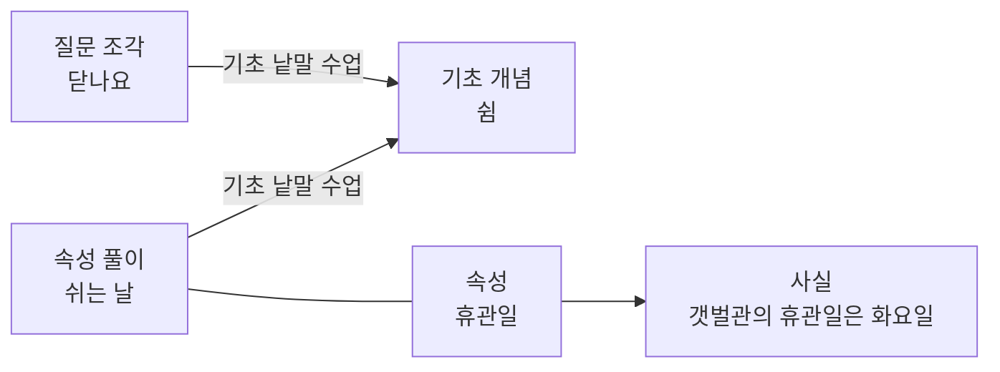

# 목표 1 설계안: 기초 낱말을 가르친다 (2026-11-25)

구현 담당이 소유자의 요청으로 쓴 설계안이다. 아직 만든 것은 없다. 11절의 결정을 받은 뒤에 시작한다. 구조는 `goal-1-structure-2026-11-25.md`의 네 칸을 따른다.

## 1. 왜 이 방향인가

같은 날 세 가지를 시도했고 모두 새 분야에서 통하지 않았다.

| 시도 | 재료 | 새 묶음에서 |
| --- | --- | --- |
| 보통 글에서 센 횟수 | 210만 문장 | 맞는 제안 +6, 엉뚱한 제안 +6 (노출된 묶음) |
| 사전 한 걸음 | 표준 사전, 한자 훈 | 맞는 것 6, 틀린 것 9 (노출된 묶음) |
| 둘이 겹칠 때만 | 위 둘 | 노출된 묶음 +14, 새 묶음 +2 |

셋 다 "가르치지 않고 알아서 알게 하려는" 방법이었다. 소유자의 결론은 이렇다: 모르는 것을 알게 하는 길은 교육뿐이다. 다만 사람이 쓰는 말에는 한계가 있으니, 최소한의 기초를 가르치면 나머지는 그 기초에서 풀어낼 수 있다.

이 결론을 뒷받침하는 숫자를 세었다. 다섯 외부 묶음에서 답이 있는데도 보류된 질문 71개의 못 읽은 낱말 323개를 국립국어원 "한국어 학습용 어휘" 목록(빈도순 5,888낱말)에 대 보았다.

| 목록의 범위 | 들어 있는 낱말 |
| --- | --- |
| 앞 1,000낱말 | 66% |
| 앞 3,000낱말 | 80% |
| 전체 | 93% |

급히 만든 맞춤이라 양쪽으로 오차가 있다(한 글자 명사를 못 맞췄고, `걸어요`를 `걸어오다`로 읽었다). 정말로 목록 밖인 것은 `접수`, `입주`, `수용`, `단기` 같은 한자어 몇 개와 분야 낱말뿐이었다. 가르칠 양은 유한하다.

## 2. 무엇을 가르치는가

자료 세 가지다. 코드가 아니라 그래프에 들어가는 자료다.

| 자료 | 칸 | 누가 쓰나 | 예 |
| --- | --- | --- | --- |
| 기초 개념 | ① | 한 번, 미리 | `쉼`, `돈`, `곳`, `때`, `사람`, `수`, `줌`, `감` |
| 기초 낱말 수업 | ③ | 한 번, 미리 (11절에서 정함) | `닫다` → `쉼` / `내다` → `돈`, `줌` |
| 속성 풀이 | ④ | 분야를 넣는 사람 | `휴관일`: 쉬는 날 |

- **기초 개념**은 언어와 무관한 뜻의 마디다. 낱말이 아니라 낱말이 가리키는 곳이다.
- **기초 낱말 수업**은 한국어 낱말 하나가 어느 개념을 가리키는지 적는다. 뜻이 여럿이면 여럿을 다 적는다.
- **속성 풀이**는 분야의 속성을 쉬운 말 한 줄로 적은 것이다. 지금 어휘 팩의 `also`(다른 말)와 같은 자리에 둔다.



사전 시도와 다른 점은 둘이다. 글자가 아니라 개념에서 만난다(`닫나요`와 `쉬는`은 글자가 하나도 안 겹친다). 그리고 양쪽 모두 누군가 가르친 것이라 근거가 붙는다.

## 3. 수업의 모양

### 3.1 기초 낱말 수업

낱말 하나에 줄 하나다.

```json
{"word": "닫다", "kind": "verb", "senses": [["쉼"], ["막음"]], "taught_by": "...", "at": "2026-11-25"}
{"word": "내다", "kind": "verb", "senses": [["돈", "줌"], ["밖", "옮김"]], "taught_by": "...", "at": "..."}
{"word": "어디", "kind": "asks", "senses": [["곳"]], "taught_by": "...", "at": "..."}
{"word": "하다", "kind": "light", "senses": [], "taught_by": "...", "at": "..."}
```

- `senses`는 뜻마다 개념 묶음 하나다. 뜻이 둘이면 둘 다 적는다. 고르는 것은 4절의 맞추기가 한다.
- `light`는 뜻을 싣지 않는 낱말이다(`하다`, `있다`, `되다`, `수`, `것`). 이것을 가르쳐 두어야 "설명 안 된 조각"으로 남지 않는다.
- 개념으로 바로 적기 어려운 낱말은 이미 가르친 낱말로 풀어 적는다: `{"word": "찾아가다", "by_words": ["가다"]}`. 풀이에 쓰는 낱말은 그 줄보다 먼저 가르친 것이어야 한다. 들일 때 이 순서를 검사하므로 풀이를 따라가면 반드시 끝난다.

### 3.2 속성 풀이

어휘 팩의 속성 항목에 한 줄을 더한다.

```json
{"word": "휴관일", "also": ["휴무일"], "explained": "쉬는 날"}
{"word": "이용료", "also": ["요금", "입장료"], "explained": "들어갈 때 내는 돈"}
{"word": "정원", "also": ["수용인원"], "explained": "한 번에 들어갈 수 있는 사람 수"}
{"word": "관리처", "also": ["관리기관"], "explained": "맡아서 운영하는 곳"}
```

풀이에 기초 낱말이 아닌 말이 있으면 들일 때 그 낱말을 짚어 알려 준다("풀이의 `접수`를 모릅니다"). 분야를 넣는 사람이 쉬운 말로 고쳐 쓰거나 그 낱말을 가르친다. 교육이 일어나는 자리가 질문 때가 아니라 지식을 넣을 때로 옮겨진다.

## 4. 풀어내기 (사색)

질문을 문장으로 읽지 못했고 대상은 알아봤을 때만 쓴다. 지금의 `answer._anchor` 자리다.

1. 못 읽은 조각마다 기초 낱말을 찾는다. 어간과 어미를 가르는 것은 읽기 쪽에 이미 있는 글자 단위 어미 표를 쓴다. 한 조각이 두 낱말로 읽히면(`걸어요`: `걸다`, `걷다`) 둘 다 남긴다.
2. 낱말의 뜻을 개념으로 푼다. `by_words`는 따라 내려간다.
3. 그 대상이 가진 속성마다, 속성 풀이의 개념과 질문 조각의 개념을 맞춘다.
4. 모든 조각이 다음 중 하나로 설명되면 그 속성이 후보다.
   - 속성 풀이의 개념에 들어 있다.
   - `light`다.
   - 지금도 설명되는 것이다(대상 이름, 의문사, 세는 말, 지식에 있는 꾸밈말·시점).
5. 후보가 하나면 그 속성으로 이해한다. 둘 이상이거나 설명 안 된 조각이 있으면 6절의 등급으로 간다.

규칙은 하나만 더한다. **풀어낸 연결은 후보를 더하기만 하고 빼지 않는다.** 2단계 실패(`ad18b1e`)가 후보를 빼다가 난 일이다.

## 5. 예시로 걸어 보기

다섯째 묶음의 질문이다. 설계를 설명하려는 것이고 측정이 아니다.

| 질문 | 풀이 | 결과 |
| --- | --- | --- |
| `갯벌관은 무슨 요일에 문을 닫나요?` | `닫다` → 쉼, `요일` → 때. 휴관일 = 쉬는 날(쉼, 때). 다른 속성은 쉼이 없다 | 휴관일 하나 |
| `산호관에 들어가려면 얼마를 내야 해요?` | `들어가다` → 감, `얼마` → 수·돈, `내다` → 돈·줌. 이용료 = 들어갈 때 내는 돈 | 이용료 하나 |
| `산호관에는 한꺼번에 몇 명까지 들어갈 수 있나요?` | `몇 명` → 사람·수, `들어가다` → 감. 정원과 이용료 둘 다 `감`이 있지만 `사람·수`는 정원에만 있다 | 정원 하나 |
| `산호관 어린이 요금 얼마?` | `어린이` → 사람(어린). 이용료의 풀이에 없고 지식의 꾸밈말에도 없다 | 설명 안 된 조각. 보류 |
| `갯벌체험관 어디야?` | `어디` → 곳. 위치 = 있는 곳, 관리처 = 맡아 운영하는 곳. 둘 다 곳이다 | 후보 둘. 골라 묻기 |

넷째 줄이 중요하다. 오늘 엉뚱한 제안의 원인이 `어린이`를 조건으로 알아보지 못한 것이었다. 기초 낱말로 가르쳐 두면 "아는 낱말인데 이 속성의 풀이에도, 지식의 꾸밈말에도 없다"가 되어 조건으로 남는다.

다섯째 줄은 이 설계로도 답이 정해지지 않는다. 넷째 묶음에서 본 것처럼 정말로 두 가지로 읽히는 질문이다. 후보를 보여 주고 고르게 한다.

## 6. 답의 등급

| 경우 | 지금 | 이 설계 |
| --- | --- | --- |
| 모든 조각이 설명되고 후보가 하나 | (해당 없음) | 처음에는 **제안**. 새 묶음에서 엉뚱한 제안이 0이면 **가정 답**으로 올릴지 따로 정한다 |
| 후보가 둘 이상 | 보류 | 후보를 보여 주고 골라 묻기 |
| 설명 안 된 조각이 있음 | 보류 | 보류. 어느 조각을 모르는지 말한다 |

가르친 것에서 풀어낸 것은 추측과 다르다. 그래도 낱말의 뜻이 여럿이라 잘못 고를 수 있으므로 한 번에 답으로 올리지 않는다. 사용자가 "맞아"라고 한 것은 분야 쪽에 저장해서 다음부터 묻지 않는다(구조 노트 6절의 3단계).

## 7. 가르칠 양

목록에서 센 것이다.

| 범위 | 서로 다른 낱말 | 그중 `-다`로 끝나는 것 |
| --- | --- | --- |
| 앞 1,000 | 942 | 290 |
| 앞 2,000 | 1,887 | 597 |
| 앞 3,000 | 2,820 | 901 |

- 첫 단계는 앞 1,000낱말 전부다(942줄). 못 읽은 낱말의 66%가 여기에 있다.
- 기초 개념은 수업을 쓰면서 정해지는데, 수십 개에서 백여 개를 예상한다. 정해 놓고 시작하지 않는다. 수업 942줄을 쓴 뒤 실제로 쓰인 개념을 센다.
- 어디까지 넓힐지는 첫 측정 뒤에 정한다.

## 8. 과적합을 막는 장치

오늘 +14가 +2로 줄어든 일을 되풀이하지 않기 위한 것이다.

1. **가르칠 낱말은 빈도 순위로 자른다.** 실패한 질문에서 고르지 않는다. 앞 1,000이면 1,000 전부다.
2. **수업을 쓰는 쪽은 외부 묶음을 보지 않는다.** 구현 담당은 다섯 묶음을 다 봤으므로 수업을 쓰지 않는다.
3. **속성 풀이는 출제자가 쓴다.** 출제 안내문에 "속성마다 쉬운 말 한 줄 풀이"를 더한다. 출제자는 기초 낱말 목록을 모른다.
4. **코드와 수업을 동결한 뒤 새 묶음을 받아 한 번 돌린다.** 그 뒤에는 아무것도 고치지 않는다.
5. **다섯 노출 묶음은 속성 풀이가 없어 그대로는 쓸 수 없다.** 구현 담당이 풀이를 지어 붙여 돌린 숫자는 장치가 도는지 보는 확인일 뿐이다.

## 9. 코드 규모

- 새 자료 파일 둘: 기초 개념, 기초 낱말 수업.
- `pack.with_words`: 속성의 `explained`를 받고, 모르는 낱말을 짚어 알린다.
- `answer._anchor`: 4절의 맞추기 하나. 설명 못 한 조각을 세는 지금의 흐름에 얹는다.
- 어미 처리는 새로 만들지 않고 읽기 쪽 것을 쓴다. 쓸 수 있는지는 시작할 때 먼저 확인한다.
- 구조 규칙(구조 노트 8절): 기초 낱말 자료 없이 돌리면 출하 팩 다이제스트와 외부 묶음 출력이 지금과 같아야 한다.

## 10. 이 설계로 풀리지 않는 것

- **두 가지로 읽히는 질문.** `어디야?`는 고르게 물을 수 있을 뿐이다.
- **문장 구조.** `현악대여소가 있는 건물의 전화번호`는 낱말이 다 기초인데 구조를 못 읽는다. 연쇄는 이 설계의 둘째 단계로 미룬다(첫 고리를 풀이로 찾고 둘째 고리를 속성 낱말로 찾는 것).
- **기초 밖의 낱말.** `접수`, `입주` 같은 말은 분야를 넣는 사람이 `also`나 풀이로 적어야 한다.
- **최신 말.** 배우기 전에는 모른다. 다만 배울 때 기초 낱말 한 줄이면 된다.
- **뜻이 여럿인 낱말의 오독.** `들다`(돈이 들다, 손에 들다, 안에 들다)처럼 뜻이 많은 낱말은 엉뚱한 속성과 맞을 수 있다. 그래서 6절에서 처음에는 제안으로만 낸다.

## 11. 소유자가 정할 것

1. **수업을 누가 쓰는가.** 942줄이다.
   - (가) 토큰 기반 교사가 초안을 쓰고 소유자가 검토한다. 빠르다. 실행 때는 교사가 돌지 않으므로 "토큰 기반이 아니다"는 유지되지만, 교사를 쓸지는 미정으로 남겨 두신 결정이다.
   - (나) 소유자가 손으로 쓴다. 느리지만 근거가 가장 분명하다.
   - (다) 표준 사전의 뜻풀이에서 기계로 뽑는다. 오늘 사전 시도의 잡음을 그대로 가져온다. 권하지 않는다.
   - 구현 담당의 권고는 (가)다. 낱말마다 `taught_by`를 남기고, 소유자는 뜻이 여럿인 낱말만 골라 본다.
2. **첫 범위.** 앞 1,000낱말로 시작하는 것을 권한다.
3. **출제 안내문에 속성 풀이를 더해도 되는가.** 더하면 앞의 다섯 묶음과 숫자를 바로 견줄 수 없다. 새 묶음을 "풀이 있음"과 "풀이 없음" 두 설정으로 돌려 차이를 본다.
4. **후보가 둘일 때 골라 묻기를 이 작업에 넣는가, 따로 하는가.** 따로 하는 것을 권한다. 동작이 달라지는 것을 한 번에 하나씩 재기 위해서다.
