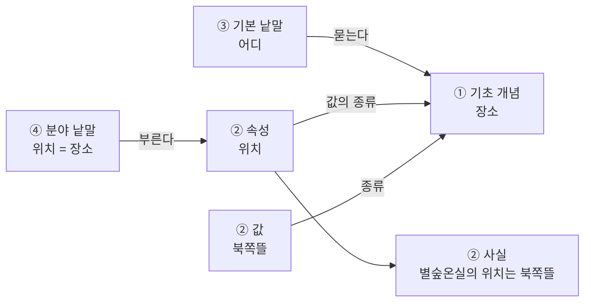

# 목표 1 구조 정리: 네 칸 (2026-11-25)

소유자와 구현 담당이 2026-11-25에 합의한 구조다. 코드 변경은 없고, 지금 있는 것을 어디에 두어야 하는지와 비어 있는 곳을 적는다. 이후 작업은 이 문서의 순서를 따른다.

## 1. 왜 다시 정리하는가

지금까지는 "언어 팩"과 "분야"(어휘 팩, 지식) 둘로 나눴다. 그런데 실제로는 성격이 다른 것이 넷 섞여 있고, 그 때문에 같은 종류의 문제가 되풀이됐다.

- 지식이 필요 없는 아주 기본적인 것(의문사, 달력 낱말, "얼마가 무엇을 묻는가")이 세 군데에 흩어져 있다.
- "장소", "금액" 같은 기초 개념이 어디에도 없어서, `어디`가 위치를 묻는지 관리처를 묻는지를 대화 기록에서 추측한다.
- 지식 그래프가 한국어 문장 그대로라서, 지식과 그 지식을 부르는 말이 붙어 있다.

## 2. 가르는 기준 두 가지

1. **영어로 바꿔도 그대로인가?** 그대로면 언어와 무관하다.
2. **분야를 바꿔도 그대로인가?** 그대로면 일반적이다.

| | 분야를 바꿔도 그대로 (일반) | 분야마다 다름 |
| --- | --- | --- |
| **언어를 바꿔도 그대로** | ① 생각하는 법과 기초 개념 | ② 지식 |
| **언어마다 다름** | ③ 문법과 기본 낱말 | ④ 분야 낱말 |

| 칸 | 내용 | 예 |
| --- | --- | --- |
| ① | 맞추기, 한정어 규칙, 연쇄 잇기, 검증. 장소·시간·금액·수량·사람·기관 같은 기초 개념 | "주말에만 아는 값은 그냥 값이 아니다" / "장소라는 종류가 있다" |
| ② | 대상, 속성, 사실, 출처 | "별숲온실의 위치는 북쪽뜰" |
| ③ | 조사, 어미, 문장 형태, 의문사, 세는 말, 흔한 낱말 | "~의 ~는 ~이다" / "어디는 장소를 묻는다" / "올해는 시점이다" |
| ④ | 분야의 개념을 그 언어로 부르는 말, 그 속성을 묻는 표현 | "이용료 = 요금 = 입장료" / "얼마 내야 해요는 이용료를 묻는다" |

## 3. 지금 있는 것은 어느 칸인가

`experiments/graph_weighted_acquisition/` 기준이다.

| 지금 있는 것 | 어디에 있나 | 칸 | 상태 |
| --- | --- | --- | --- |
| 맞추기, 한정어 규칙(`unasked_parts`), 연쇄(`name_joins`), 두 번째 검증 | `match.py`, `answer.py` | ① | 제자리. 다만 관례가 언어 팩의 레시피 파일에 들어 있다 |
| 구조 조회, 상태 11가지, 충돌 판정 | `know.py` | ① | 제자리. reader 쪽 흐름과 아직 이어지지 않았다 |
| 기초 개념(장소·시간·금액 등) | 없음 | ① | **비어 있음** |
| 지식 문장을 읽은 그래프, 사실 팩 | `pack.load`, `blind_e2e.py`의 지식 들이기 | ② | 한국어 문장 그대로다. ④와 붙어 있다 |
| 속성의 값이 어떤 종류인가 | 없음 | ②→① 연결 | **비어 있음** |
| 수업에서 센 횟수 표(조사, 어미, 역할, 순서, 공유) | `reader.build`, `packs/make_language.py`, 수업 묶음들 | ③ | 제자리 |
| 읽기 규칙(어느 횟수가 무엇을 정하는가) | `data/reading_recipe.json`의 `recipe` | ③ | 제자리 |
| 의문사(무엇, 얼마, 언제, 어디) | 수업 문장 속의 고정 낱말 | ③ | 문법 수업에 섞여 있다. 무엇을 묻는지는 적혀 있지 않다 |
| 세는 말 `몇` | `reading_recipe.json`의 관례 한 줄 | ③ | 관례에 박혀 있다 |
| 달력·계절·요일 낱말 | `data/word_kinds_ko.json` | ③ | 제자리. 다만 "시점"과 "상황" 둘로만 나뉜다 |
| 의문사가 물었던 속성 | 대화 기억(`learn.note_ask`) | ③과 ④ 사이 | 대화가 끝나면 사라진다. ①의 개념이 있으면 추측할 필요가 없다 |
| 속성 낱말, 이름, 다른 말 | 어휘 팩 | ④ | 제자리 |
| 사용자가 확인한 표현 | 대화 기억(`learn.note_said`) | ④ | 대화가 끝나면 사라진다 |
| 문장에서 배운 낱말 종류 | 대화 기억(`learn.note_kinds`) | ④ | 대화가 끝나면 사라진다 |
| 관례 19개 | `reading_recipe.json`의 `conventions` | ①과 ③이 섞임 | 읽기 관례와 답하기 관례가 한 파일에 있다 |

## 4. 합친다는 것의 뜻

네 칸을 한 통에 섞는 것이 아니다. **하나의 그래프 안에서 서로 이어지게** 한다.

이어지면 측정에서 되풀이된 보류가 구조로 풀린다.

- `달빛관 어디야?`: `어디`는 장소를 묻고, 위치의 값은 장소이고 관리처의 값은 기관이다. 대화 기록을 볼 필요가 없다.
- `몇 번으로 걸어요?`: `몇 번`은 번호를 묻고, 전화의 값은 번호다. 지금은 값의 끝 글자(단위)로만 찾는다.
- `놋쇠는 금속` 같은 기초 지식이 들어갈 자리가 ①의 개념 층이다.

## 5. 지켜 온 원칙 (그대로 유지)

1. **토큰 기반이 아니다.** 답할 때 도는 것은 정수 횟수와 그래프 맞추기뿐이다.
2. **최소한의 코드, 최대한의 그래프.** 새 칸은 코드가 아니라 자료로 채운다.
3. **형태가 먼저다.** 낱말이나 개념에 대해 아는 것은 문장 형태가 침묵하는 자리에서만 쓴다. 낱말 지식이 읽기를 막는 거부권이 된 일이 세 번 있었다(수업 낱말, `새벽`, `화요일`).
4. **구체적인 것이 일반적인 것을 이긴다.** 분야가 적은 것(②④)이 일반 층(①③)보다 앞선다.
5. **모든 것에 근거가 붙는다.** 어느 수업, 어느 문장, 누가 언제 확인했는지.
6. **못 읽은 것을 상관없는 것으로 치지 않는다.** 모든 조각이 설명될 때만 답하고, 아니면 묻는다.
7. **미리 쓰는 목록은 닫힌 부류만.** 끝이 없는 부류는 지식, 문장, 확인에서 들어온다.

## 6. 진행 순서

한꺼번에 뒤엎지 않는다. 단계마다 외부 문항을 체크포인트별로 돌려(`probes/compare_checkpoints.py`) 같은 문항에서 전후를 본다.

| 단계 | 하는 일 | 건드리는 칸 | 겨냥하는 측정 결과 |
| --- | --- | --- | --- |
| 1 | 이 문서 | 없음 | |
| 2 | 기초 개념 몇 개(장소, 시간, 금액, 수량, 사람, 기관, 번호)를 자료로 둔다. 의문사와 세는 말이 어느 개념을 묻는지 잇는다. 속성의 값 종류는 지식의 값에서 얻거나 어휘 팩이 적는다 | ①, ③, ②→① 연결 | `어디`가 위치와 관리처 사이에서 갈리지 않는 것, `몇 번` |
| 3 | 대화 기억에 쌓인 것(확인된 표현, 낱말 종류)을 분야 쪽에 저장해 다음 대화에서 쓴다 | ④ | 맞는 제안이 답으로 바뀌는가 |
| 4 | 관례 파일을 읽기 관례(③)와 답하기 관례(①)로 나눈다 | ①, ③ | 동작 변화 없음(정리) |
| 5 | 지식 그래프를 문장에서 떼어 개념 단위로 둔다. 낱말은 개념을 가리킨다 | ②, ④ | 다른 이름·다른 언어로 물어도 같은 사실에 닿는가 |

2단계의 기초 개념은 열 개 안쪽으로 시작한다. 이 목록은 낱말 종류 목록과 같은 위험을 가진다. 그래서 처음부터 원칙 3을 적용한다: 개념은 후보를 좁히는 데만 쓰고, 형태가 정한 것을 뒤집지 않는다.

## 7. 아직 정하지 않은 것

- 속성의 값 종류를 누가 적는가. 지식의 값을 보고 얻을 수 있는 것(금액, 수량, 시각)과 그럴 수 없는 것(장소인가 기관인가)이 있다. 후자는 어휘 팩이 적거나, 값이 다른 사실의 대상으로 나오는지로 가린다(관리처의 값은 전화를 가진 대상이다).
- 3단계의 저장 위치와 형식.
- 토큰 기반 모델을 교사로 써서 ④의 표현을 대량으로 받을지. 3단계를 하고 얼마나 퍼지는지 잰 뒤에 정하기로 했다.
- `know.py`의 구조 조회 흐름과 reader 쪽 흐름을 하나로 잇는 시점.

## 8. 2단계를 시도했다가 뺐다 (2026-11-25)

- 시도한 것(`ad18b1e`): 기초 개념을 대상(값이 제 사실을 가짐) / 수량(값에 숫자) / 이름(둘 다 아님) 셋으로 두고, 맨 `어디`는 이름을, 맨 `얼마`는 수량을 묻는다고 이었다. 노출된 2·3차 외부 묶음에서는 맨 `어디` 질문이 가정 답으로 바뀌어 좋아 보였다.
- 새 묶음으로 잰 결과(4차, 악기대여소, `probes/outside4_e2e_20261125`): 위치의 값이 전화와 관리처를 가진 건물인 분야다. `현악창구 어디?`에 관리처(`현악지원팀`)를 가정 답으로 냈다. 위치가 "대상" 종류, 관리처가 "이름" 종류로 뒤집혔기 때문이다. 2단계 전(`2c3944f`)은 이 질문을 두 후보와 함께 보류했고 틀림이 0이다.
- 처리: 2단계는 이 브랜치에서 뺐고, 로컬 브랜치 `failed/goal1-step2-basic-concepts`에 기록과 함께 남겼다. 이 브랜치의 동작은 `2c3944f`와 같다.
- 왜 이렇게 됐나: 2단계는 자리 정리라고 적었지만 실제로는 새 추측 규칙이었다. 7절에 미정으로 적어 둔 "장소인가 기관인가는 지식만 보고 못 가린다"를 그대로 밀어붙였다.
- 여기서 남기는 규칙:
  1. **추측으로 얻은 것은 답을 만들지도, 후보를 빼지도 못한다.** 낱말 종류, 기초 개념, 값의 생김새가 여기에 든다. 답을 정하는 것은 문장 형태, 분야가 직접 적은 것, 사용자가 확인한 것이다.
  2. **구조 단계는 동작이 그대로여야 한다.** 출하 팩 다이제스트와 외부 묶음 출력이 같을 것. 동작이 바뀌는 것은 따로 내놓고 새 묶음으로 잰다.
- 6절 표의 2단계는 이 형태로는 하지 않는다. 네 칸 구조 자체는 유지한다. 다음 방법은 `2c3944f`의 동작에서 다시 찾는다.

## 9. 말투 → 속성 연결: 시도하고 뺀 것 (2026-11-25)

- 남은 문제: 질문의 말(`걸어요`, `쉬어요`)과 지식의 낱말(`전화`, `휴무일`)을 잇는 다리가 문장 형태에도 지식에도 없다.
- **사전 뜻풀이 그래프:** 이 프로젝트 초기에 해 봤고, 최신 말에 소용이 없어 폐기된 방법이다. 다시 하지 않는다.
- **보통 글에서 센 횟수:** 질문·답 사이트 글 210만 문장에서 속성 낱말 옆에 우연보다 자주 나오는 낱말을 세어 제안 후보로 썼다. 가볍고(분야당 십몇 초, 수백 KB) 일부 다리는 실제로 놓였다(`걸다` → 전화). 그러나 노출된 묶음 네 벌에서 맞는 제안 +6, 엉뚱한 제안 +6이었다. "옆에 자주 나온다"는 "그것을 묻는다"가 아니다(`어린이`는 요금 옆에 자주 나온다). 분야의 속성 이름은 보통 글에 드물다. 로컬 브랜치 `failed/goal1-wording-counts`에 남기고 이 브랜치에서는 뺐다.
- 이 브랜치의 동작은 여전히 `2c3944f`와 같다.

## 10. 두 출처가 겹칠 때만 (2026-11-25, 만들었고 아직 새 묶음으로 재지 않음)

- 사전 방식을 다시 본 것은 소유자의 제안이다. 예전에는 "모든 낱말을 이해한다"로 시작해서 뜻만 찾고 끝났다. 이번에는 양 끝(질문의 조각, 분야의 속성 낱말)이 이미 있고 한 걸음만 간다: 속성 낱말의 뜻풀이와 한자 훈(`休務日` → 쉴 휴). 한자로 풀기는 보통 글에 드문 속성 이름(대여기간)에도 통한다.
- 사전만 쓰면 맞는 만큼 틀린다(6 대 9). 보통 글의 횟수만 써도 그렇다(10 대 10). 그런데 둘이 같은 속성을 가리킬 때만 쓰면 11 대 2였고, 그 2도 연쇄의 첫 고리를 맞게 짚은 것이었다. 두 출처는 틀리는 방식이 달라서 함께 틀리는 일이 드물다.
- 만든 것: `lexicon.py`(사전 한 걸음), `wording.py`(글에서 센 횟수), `answer._both_point`(둘이 겹치는 속성). 제안까지만 쓰고, 속성 낱말이 따로 있으면 연쇄 후보로 낸다. 출처 없이 돌리면 `2c3944f`와 출력이 같다.
- 노출된 묶음 네 벌에서(확인용): 엄격한 멈춤 규칙이면 맞는 제안 +4, 엉뚱한 제안 0. 느슨한 규칙이면 맞는 제안 +14(연쇄 4개 포함), 엉뚱한 제안 +6. 틀린 답은 둘 다 0.
- 규칙과 문턱값을 이 묶음들을 보며 정했다. 새 외부 묶음에서 두 규칙을 모두 재기 전에는 아무것도 주장하지 않는다.
- 멈춤 규칙의 중간(`between`)을 소유자 요청으로 더했다: 설명 안 된 명사를 통과시킨 경우, 속성 낱말만 보고 대상에 바로 붙이는 경로만 계속 막는다(`N의 P`에서 모르는 N은 P의 주인일 가능성이 높다). 노출된 묶음에서 맞는 제안 +14(느슨한 규칙과 같음), 엉뚱한 제안 +3(느슨한 규칙은 +6). 같은 묶음을 보고 만든 세 번째 규칙이므로, 새 묶음에서 세 규칙을 한 번씩 돌려 본다.
- 다섯째 외부 묶음(해안생태체험단지, 답 있는 질문 52개, 없는 질문 18개)을 `8f58739`에서 설정마다 한 번씩 돌렸다. 출처 없음: 맞음 6, 가정하고 맞음 8, 맞는 제안 16, 엉뚱한 제안 1, 보류 22, 옳게 보류 17, 틀린 답 0. `word` 맞는 제안 +1, `between` +2, `question` +2에 엉뚱한 제안 +1. 틀린 답은 모두 0.
- 노출된 묶음에서 본 +14는 새 묶음에서 +2였다. 두 출처가 겹치는 경우가 새 분야에서는 드물었다. 동사로 묻는 질문 14개 중 보류는 10개에서 9개로 줄었을 뿐이다. 해가 되지는 않았지만 낯선 말투 문제를 풀지는 못했다.
