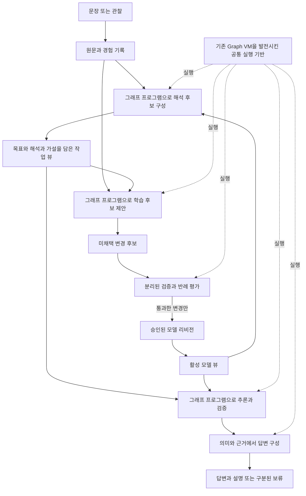

# MARCO 그래프 중심 실행과 학습 설계안

2026년 10월 22일. 본체 구현을 바꾸기 전의 목표 구조다. 현재 승인 본체 V77, 기존 팩과 이전 평가 결과는 유지한다.

MARCO의 판단 방식은 그래프가 정의한다. Python은 그래프를 읽고 매칭하고 변환하는 공통 계산 기반을 제공한다. 새 언어 표현, 관계, 추론 전략을 추가할 때 실행기의 Python을 수정하지 않는 것을 구조의 합격 기준으로 삼는다. 그래프에 저장하기만 하고 별도 Python 분류기가 해석하는 방식은 이 기준을 충족하지 않는다.

## 목표와 실행 경계

현재 목표는 토큰 생성 언어모델 없이 그래프에 표현된 근거와 절차로 입력을 이해하고 답변을 만드는 시스템이다. 문자와 출력 문자열은 입출력에 필요하지만, 고정된 토큰 어휘나 다음 토큰 예측기를 실행 기반으로 요구하지 않는다. 학습된 구간 경계와 표현 묶음은 그래프 데이터다.

답변은 근거가 뒷받침하는 범위에서 생성한다. 정보 부족, 여러 해석, 충돌, 계산 한도는 서로 다른 결과다. 그래프 방식 자체가 모든 질문의 정답이나 임의의 문장의 이해를 보장하지 않는다.

미래 목표는 내부 상태, 목표 선택, 호기심, 감정 관련 경험, 전략 개선과 창조적 가설 생성을 같은 기반에 추가하는 것이다. 이들은 현재 언어 이해가 완성됐다는 가정 없이, 별도 검증 가능한 능력으로 확장한다.

| Python의 고정 책임 | 그래프가 정의할 내용 |
| --- | --- |
| 저장, 식별자, 자료형, 원문 구간과 출처 무결성 | 어휘, 표현, 문법, 의미 역할과 연결 |
| 범용 탐색, 패턴 매칭, 변수 바인딩, 그래프 변환 | 추론 규칙, 적용 조건, 전략과 실행 순서 |
| 문자열 구간 연산과 수치 계산 | 의미를 문장으로 실현하는 구성과 표현 선택 |
| 연산 예산, 프로그램 권한, 원자적 변경 | 학습 후보 생성, 비교, 반례 탐색과 채택 정책 |

Python에 특정 관계의 뜻, 한국어 품사·어미 목록, 문장별 분기, 전용 답변 틀을 추가하지 않는다. 커널의 연산 의미와 무결성 검사는 코드의 책임이다. 코드가 의미 없는 전기 그 자체일 수는 없으므로, 이 최소 연산의 경계를 명시하고 고정한다.

## 하나의 실행 기반



이해기, 추론기, 학습기는 서로 다른 Python 엔진이 아니라 공통 실행기에 올리는 그래프 프로그램이다. 각 프로그램은 자신의 입력·출력과 권한을 선언한다. 읽기 전용 분석과 실제 상태 변경은 구분한다.

기존 PackBase, GraphView, OverlayAttachment, Overlay, LearningMemory, Hypomnema와 Snapshot의 책임을 유지한다. 새 저장소·로그 시스템·병렬 추론 엔진을 만들지 않는다. 기존 Graph VM의 확장은 격리된 후보에서 먼저 검증한다.

## 공통 그래프 표현과 네 가지 뷰

그래프 파일 하나가 뇌의 기능 하나라는 구조를 사용하지 않는다. 같은 식별자·관계·출처 계약을 사용하는 논리적 뷰를 두고, 모델은 고정된 리비전으로 선택한다. 물리적 분할과 인덱스는 저장 최적화 문제다.

| 뷰 | 담는 내용 | 변경 수명 |
| --- | --- | --- |
| 활성 모델 | 채택한 개념, 언어 구조, 규칙, 실행 전략, 실현 규칙 | 승인된 리비전 단위 |
| 경험 | 원문, 관찰, 발화자, 시점, 실행 결과와 피드백 | 원본을 보존하고 교정은 새 이력으로 추가 |
| 작업 | 현재 목표, 해석 후보, 변수 바인딩, 가설, 중간 증명과 예산 | 작업 단위로 중단·복원하거나 종료 |
| 후보 | 제안된 표현·규칙·전략 변경과 검증 기록 | 채택·거절·철회까지 활성 지식과 분리 |

이 뷰들은 자동으로 합쳐지지 않는다. 특히 기존 GraphView가 지원하지 않는 새 그래프를 Overlay에 몰래 추가하지 않는다. 초기 구현은 기존 그래프에 대한 승인된 변경 또는 명시적 팩 리비전을 사용한다.

공통 표현은 다음을 보장한다.

- **정체성:** 노드는 안정적인 ID로 구분한다. 같은 문자열, 같은 역할 이름, 같은 형상이라는 이유만으로 합치지 않는다. 별칭과 동치도 출처 있는 관계다.
- **역할:** 사실과 사건은 역할 연결을 가진 명제 노드로 표현한다. 주체·대상·장소라는 이름을 커널에서 해석하지 않고, 선택 모델의 역할 ID를 따른다.
- **범위:** 긍정·부정, 단언·인용·조건·가설, 대화·시점·전제 범위를 명제에 연결한다. 정보 없음과 명시적 부정을 구분한다.
- **근거:** 원문 참조와 구간, 적용한 규칙 리비전, 전제 노드, 실행 단계를 보존한다. 수치 점수가 있다는 이유로 사실로 승격하지 않는다.
- **상태:** 후보, 채택, 거절, 철회를 구분한다. 활성 여부는 후보 그래프 자신의 주장만으로 바뀌지 않는다.

반복되는 문자열을 매번 새 노드로 복제하거나 원문의 모든 문자를 노드로 만들 필요는 없다. 원문은 한 번 보존하고 구간으로 참조한다. 상태나 근거가 있는 명제 노드를 공유 문자열과 혼동하지 않는다.

공통 저장 계약은 아래 최소 필드를 기준으로 구체화한다. 언어별·도메인별 역할은 필드 이름으로 추가하지 않고 관계 ID로 표현한다.

| 레코드 | 필수 연결 |
| --- | --- |
| 노드 | 안정 ID, 타입 참조, 소속 범위, 필요한 경우 리터럴 값 |
| 연결 | 안정 ID, 출발 노드, 관계 ID, 도착 노드, 근거 참조 |
| 원문 참조 | 경험 ID, 원문 해시, 구간 좌표계와 시작·끝 위치 |
| 명제 | 관계·사건 ID, 역할별 참여자 연결, 극성·양태·시점·대화 범위, 근거 |
| 실행 기록 | 프로그램과 모델 리비전, 입력·바인딩 참조, 적용 단계, 결과 참조, 소비 예산 |
| 변경 후보 | 부모 모델 리비전, 제안 변경, 학습 근거, 검증 기록, 채택 상태 |

같은 노드·연결 레코드로 상위 구조를 표현하되, 명제·프로그램·후보가 서로 다른 타입이라는 경계는 유지한다. 이 계약을 먼저 버전으로 고정하고, 이후 새 의미를 넣을 때 공통 필드를 계속 추가하는 방식을 피한다.

## 공통 실행기의 연산 계약

현재 VM의 `set`, `scan`, `branch`, `match`, `append`, `intersect`, `return`은 유지한다. 이 연산만으로 그래프 저장소 접근, 재사용 가능한 하위 프로그램, 통계 학습까지 이미 가능하다고 가정하지 않는다. 다음 범용 기능의 필요성과 정확한 계약을 먼저 검증한다.

| 기능 | 범위 |
| --- | --- |
| 뷰 조회 | 명시된 뷰에서 ID·관계·원문 구간 패턴으로 제한된 결과 조회 |
| 하위 프로그램 호출 | 선택 모델의 인증된 프로그램만 호출하고 부모와 예산 공유 |
| 변환 제안 | 바인딩에서 새 노드·연결·철회 후보를 구성하며 활성 모델은 직접 수정하지 않음 |
| 값 계산 | 문자열 구간·결합·정규화, 수치·집계·비교 같은 명시적 순수 연산 |

이는 새 엔진이 아니라 기존 실행기에 대한 검토 대상이다. 계산 기능을 통해 임의 Python, 파일 경로, 셸, 네트워크 함수를 실행하지 않는다. 필요한 외부 관찰은 명시적 권한을 가진 호스트 인터페이스가 제공한다.

호스트는 원문 보존, 예산, 타입, 읽기·쓰기 권한과 원자적 커밋을 강제한다. 어떤 의미가 유효하고 어떤 전략을 적용할지는 그래프가 표현한다. 실행할 프로그램은 명시된 진입점과 권한으로만 선택한다. 사용자 문장이나 일반 지식 노드에 실행 표지가 있다는 이유로 실행하지 않는다.

## 한 문장을 처리하는 계약

1. 원문과 관찰 ID를 보존한다. 이해하지 못한 문장도 원문을 잃지 않는다.
2. 활성 언어 구조를 매칭해 구간·역할·의미 후보와 대응 근거를 작업 뷰에 만든다.
3. 전체 원문을 어떻게 설명했는지 확인하고, 대화의 현재 근거로 해석 후보를 비교한다. 맞지 않는 구간을 명사 하나로 삼켜서 성공시키지 않는다.
4. 해석이 확정되면 적절한 범위의 관찰로 채택한다. 미확정 해석은 작업 후보로 남기고 사실로 사용하지 않는다.
5. 질문이면 활성 규칙과 전략 그래프로 근거를 결합한다. 작업 그래프가 원래 목표, 실패한 경로, 부족한 전제와 남은 예산을 유지한다.
6. 답변 의미 노드에서 실현 그래프를 실행한다. 선택된 표현과 바인딩에서 문자열을 구성하고, 답변의 지칭·부정·범위가 원래 의미와 일치하는지 검증한다.
7. 답변과 함께 근거 명제, 적용 규칙, 대화 참조를 반환한다. 보류이면 모호함·정보 부족·충돌·처리 실패·예산 소진을 구분한다.

생성은 전체 문장 예시를 찾아 복사하는 것으로 한정하지 않는다. 같은 실현 구조에 새 개체·관계를 바인딩할 수 있어야 한다. 기존 Python 해석기로 몰래 우회해서 새 경로의 성공으로 계산하지 않는다.

## 학습이 실제 능력이 되는 경로

학습 후보도 활성 모델과 같은 노드·역할·프로그램 계약으로 만든다. 별도 분류기 전용 JSON을 만든 뒤 이를 다시 사람이 언어 규칙으로 옮기는 과정을 최종 구조로 삼지 않는다.

학습 그래프는 경험에서 반복 구간, 대체 가능한 표현, 여러 문맥의 용례, 조합 제약과 예외 후보를 제안한다. 글자 모양의 유사성과 문맥에서의 역할 동치는 서로 다른 근거다. 낯선 단어의 역할은 그 단어가 쓰인 다른 용례와 연결할 수 있어야 한다. 근거가 없으면 알 수 없음을 유지한다.

비지도 구조 발견으로 역할과 문법의 후보를 만들 수 있지만, 문장 빈도만으로 현실의 뜻과 참을 확정하지 않는다. 관찰·행동 결과·대화 확인·반례 같은 접지가 의미 채택의 근거가 된다. 최초의 최소 실행 프로그램과 학습 절차도 초기 그래프로 제공해야 하며, 아무 기반 없이 지능이 생긴다고 가정하지 않는다.

채택 경로는 `제안 → 고정 → 분리된 새 사례 검증 → 승인된 변경 → 사용 → 반례에 따른 철회`다. 실패와 첫 점수는 그대로 보존한다. 후보를 만든 절차가 자신의 평가 문제·정답·채택 권한을 함께 고쳐 통과시키지 못하게 한다.

규칙을 수정하는 학습 정책도 같은 후보 경로를 따른다. 후보는 현재 커널의 권한·예산·출처 검사와 자기 채택 금지를 우회할 수 없다. 원본 팩과 과거 대화가 참조한 모델 리비전은 유지한다.

## 미래의 자발적 사고와 감정 학습

자발적 사고 프로그램은 경험·미해결 목표·정보 공백에서 다음 목표를 제안한다. 실행기는 총 예산, 동일 상태 반복, 새 근거 유무, 중단 요청을 확인한다. 하위 질문을 만들 때 부모 목표를 보존하고, 새 정보나 검증 가능한 시도 없이 질문만 반복하는 작업은 멈춘다.

감정 관련 상태는 사건, 평가, 목표, 내부 상태 변화와 경험 결과를 연결하는 그래프로 확장한다. 감정 이름을 넣는 것과 경험에서 반응을 학습하는 것은 구분한다. 창조적 결과는 기존 구조의 조합과 새 가설로 제안하고, 검증 전에는 지식으로 승격하지 않는다. 이 구조만으로 주관적 감정이나 의식이 입증되지는 않는다.

## 기존 책임의 전환

| 현재 책임 | 목표에서의 위치 |
| --- | --- |
| PackBase와 GraphView | 활성 모델과 명시된 변경 뷰를 읽는 기반 유지 |
| OverlayAttachment와 Overlay | 정확한 모델 바인딩, 승인 변경·철회 이력 유지 |
| LearningMemory | 같은 그래프 계약의 후보·검증·채택을 관리 |
| Hypomnema와 Snapshot | 증명·실행 기록, 모델 리비전에 묶인 중단·복원 유지 |
| PackModel과 projection | 그래프 검증·인덱스·실행 연결로 범위를 좁힘. 선택 의미를 별도 해석기에 다시 구현하지 않음 |
| RelationalParser와 Context | 기존 호환 경로는 보존하고 격리된 새 경로와 비교. 언어·추론 판단은 검증된 범위부터 그래프 프로그램으로 이전 |
| Graph VM | 같은 커널로 이해·추론·실현·학습 프로그램을 실행하도록 점진 확장 |

공통 표현을 쓴다는 이유로 서로 다른 역할·sense·대화 정체성을 합치지 않는다. 기존 Context를 처음부터 삭제하거나 검증을 생략해 단순화하지 않는다.

## 구현 순서와 합격 기준

| 단계 | 만드는 것 | 다음 단계로 가는 조건 |
| --- | --- | --- |
| 1 | 공통 그래프 계약과 기존 VM의 범용 조회·호출·변환 계약 | 원문·범위·정체성·증명·예산이 표현되고 중단·복원에서도 보존됨 |
| 2 | 한정된 문장 이해·추론·답변의 동일 커널 실행 | 새 개체·표현 조합을 새 문제로 평가하고 기존 Python 의미 경로 우회가 없음 |
| 3 | 그래프만 바꿔 새 표현과 새 관계를 추가 | 커널 바이트가 같고, 이해·추론·생성·설명 전체가 바뀐 그래프를 사용함 |
| 4 | 용례에서 언어 구조 후보를 발견하고 같은 계약으로 채택 | 학습하지 않은 표현에서 실제 답변 개선, 반례·부정·모호함·철회 보존 |
| 5 | 추론 규칙과 전략의 학습 | 같은 정보에서 새 문제의 실제 해결 능력이 개선되고 비용·퇴보를 함께 기록 |
| 6 | 자발적 목표와 내부 상태 학습 | 목표 보존, 반복 종료, 유용한 정보 획득과 상태 변화의 재현 가능한 검증 |

첫 구현은 새 실험 엔진이나 통계 그래프를 하나 더 만드는 작업이 아니다. 기존 VM 위에서 같은 그래프 계약으로 입력부터 답변까지 연결되는 작은 수직 경로다. 새 사례로 이전 버전과 비교한 뒤에만 본체 반영을 검토한다. 성능, 경량성, 설명 가능성, 언어 이해는 각각 측정하며 하나의 점수로 대신하지 않는다.

## 설계 검토 기준

- 새 표현·관계·전략을 추가할 때 Python의 의미 분기가 늘어나지 않는가.
- 학습 후보가 채택 뒤 실제 해석·추론·답변에서 사용되는 동일한 구조인가.
- 학습자가 본 적 없는 원문·개체·표현 조합에서 실제 답이 좋아지는가.
- 답변의 근거 명제·규칙·원문 구간을 설명할 수 있는가.
- 모름, 부정, 충돌, 인용, 가설과 예산 소진을 섞지 않는가.
- 그래프·메모리·실행 비용을 측정하고, 중복 없는 공유 구조가 모델 정체성을 보존하는가.
- 이전 팩·첫 실패·첫 점수와 별도 과정 복원을 보존하는가.

현재의 구조 분석 근거는 [PackModel](../../pack_model.py), [Context](../../marco/reasoning/context.py), [Graph VM](../../marco/reasoning/graph_vm.py), [GraphView](../../marco/storage/graph_view.py), [표현 학습](../../marco/learning/expression_graph.py), [학습 메모리](../../marco/learning/memory.py)다. 이 설계는 해당 기반의 책임을 유지하면서 의미 처리의 위치를 바꾸는 목표를 정의한다.

## marco2 브랜치의 첫 기반

`marco2` 브랜치에서 단계 1을 시작했다. [graph_contract.py](../../marco/reasoning/graph_contract.py)는 공통 노드·연결·원문·구간을 담는 제한된 프레임을 검증한다. 타입·관계·범위는 불투명한 모델 참조이며, 이 검증이 해당 의미의 참이나 실행 권한을 보증하지는 않는다. 현재 프레임 내부의 연결과 근거 참조를 검사하고, 외부 타입·범위 정의의 해소는 후속 모델 연결 계약에 남긴다.

[graph-frame-query.json](../../programs/graph-frame-query.json)은 기존 VM의 연산만으로 레코드를 순회하고 패턴에 변수를 바인딩한다. 새 엔진·저장소·한국어 규칙은 추가하지 않았다. VM에는 기존 JSON 한도를 재사용하는 값 검증 API만 추가했다. 프레임의 각 레코드 목록은 기존 scan 한도 안의 작은 자료 뷰이며 전체 지식 그래프의 크기 제한을 새로 정의하지 않는다.

[첫 기반 검사](../../tests/test_graph_native_foundation.py)의 4개 테스트와 잘못된 자료 5종 하위 사례에서 관계 데이터 변경에 따른 결과 변화, 원문 좌표·출처 보존, 자료 분리, 잘못된 참조 거절과 예산 소진을 확인했다. 자연어 이해·학습·추론 정확도 검사는 아니다. 기본 Python에 pytest가 없어 제품 시험 전에 표준 라이브러리 unittest로 새 검사를 작성해 최초 실행했다. 이전의 닫힌 시험을 재실행하지 않았다.

다음 단계는 이 계약으로 해석 후보와 답변 의미를 표현하고 동일 VM에서 연결하는 것이다. 비지도 학습은 그 계약에 맞는 후보를 제안하도록 나중에 연결한다. 아직 발견한 통계 묶음을 의미 규칙이나 활성 지식으로 채택하지 않는다.


## 동일 VM의 작은 입력–답변 경로

Opus와 Sonnet의 실제 CLI를 병렬로 각 1회 실행했다. Opus는 기존 VM의 범용 값 구성·문자열 연산을, Sonnet은 [대화 프로그램](../../programs/foundation-dialogue.json)과 [한국어 초기 그래프](../../language_graphs/ko/foundation-bootstrap.json)를 구현했다. 두 호출의 실제 modelUsage와 정상 종료를 확인했고, 후보 원문과 감사 수선을 따로 보존했다.

Python은 제한된 객체·배열·문자열 계산과 예산 집행, 원문 출처 생성, 기존 레코드의 순서·값 보존 검사를 맡는다. 문장 형태·이름·관계·질문·응답 선택은 그래프 데이터와 프로그램에 있다. `execute_frame`은 호출자가 명시한 프로그램만 실행하며 기존 Context·parser로 돌아가는 경로가 없다. 입력 → 출처 있는 사실 연결 → 관계 조회 → 근거 있는 답변을 같은 VM으로 실행한다.

새 공개 unittest 33개를 최초 실행해 모두 통과했다. 범용 연산·크기/예산·기존 기록 보존·출처 위조 거절·사실 조회·중복 대상 제거·모호함·정보 없음·부적격 문장 보류를 확인했다. 같은 VM과 프로그램 바이트에서 초기 그래프의 표현·관계·답변 문구만 바꾼 검사도 통과했다. 이전에 닫힌 시험은 반복하지 않았다. 통과한 후보만 브랜치에 정확 복사하고 바이트를 확인했다.

이는 사람이 선언한 네 이름과 작은 고정 문장 틀의 초기 실험이다. 비지도 학습 결과나 학습하지 않은 자유 표현의 정확도 개선으로 계산하지 않는다. 상충 위치는 여러 후보로 보류하며 시간순 수정·철회는 아직 연결하지 않았다. 저장 후 별도 프로세스 복원, 실제 PackBase/Session의 권한 연결과 기존 버전 대비 독립 새 문장 평가는 이 단계에서 수행하지 않았다. 본체 승인 V77, 기존 Context·parser·기본 선택과 자동화 중단 상태는 유지한다. 다음은 비지도 발견 후보를 이 실행 계약에 연결하고 독립 새 문장으로 일반화를 측정하는 단계다.


## 분포 후보 연결의 첫 비교 — 수선 검증 대기

실제 Opus·Sonnet CLI 각 1회 병렬 구현과 교차 소스 감사를 거쳤다. 새 공개 검사 24개 최초 실행은 통과했다. 정답 라벨 없는 인공 공개 문장 16개에서 앞뒤 반복 문자열과 달라지는 구간으로 후보 61개를 발견했고, 기존 seed slot의 정확한 문맥에 연결되는 명칭 8개를 실험 bootstrap에 추가했다. 학습 문장의 사실은 0개이며 의미 기준은 기존 seed의 역할 가정이다. 이는 비지도 의미 발견이 아니다.

같은 VM·프로그램으로 처음 실행한 별도 새 16대화 비교에서 새 긍정 조합 정답은 0/8 → 1/8, 엄격 전체 대화 판정은 1/16 → 5/16이다. 부정·인용·알 수 없는 표현의 사실 비채택은 양쪽 4/4, 질문의 프레임 보존은 양쪽 16/16이다. 공개 인공 자료와 공개 개발 검사이므로 맹검이나 일반 언어 정확도 점수가 아니다. 모든 첫 답변과 점수·원본 후보는 외부 실험 폴더에 보존했다.

추가 코드·원문 감사에서 명칭 8개는 실제 label에 등록됐지만, 기존 그래프 프로그램의 `은 ` 전체 문자열 분할이 `작은·넓은·높은` 내부까지 나누는 것을 확인했다. `stmt_sp_len` 및 질문의 같은 분할 검사에서 거절되므로 등록된 표현을 실행 경로가 이용하지 못한다. 원본 프로그램과 Python을 유지한 채, 등록된 전체 subject label+particle을 대조하고 유일할 때 그 구간을 사용하는 그래프만의 수선 후보를 별도로 준비해 정적 감사를 받았다. 마침표·object suffix 내부 구분 일반화는 이 수선 범위가 아니다.

사용자의 승인 없는 재실행 금지 지시에 따라 수선 후보는 실행하지 않았다. 학습 코드·후보 bootstrap·수선 프로그램 모두 임시 실험 폴더에 있으며 브랜치 실행 경로와 main에는 반영하지 않았다. 실험 기록: `/private/tmp/marco2-surface-run-tomd_7bc`. 다음은 사용자 승인 후 기존 학습 결과를 재사용하고 완전히 새 조합으로 수선 경로를 최초 검증하는 것이다.


## 등록 명칭 경계 수선의 승인된 새 비교

사용자의 후속 실행 승인 뒤, 별도 준비한 새 집중 검사 3개를 최초 실행해 3/3 통과했다. 이어서 기존 평가와 겹치지 않는 새 긍정 조합 8개 및 정보 없음·모호함·부정·인용 각 1개, 총 12대화를 두 프로그램에서 각각 한 번 실행했다. 버전당 25입력이며 학습된 bootstrap 바이트는 양쪽 동일하고 재훈련은 없다.

새 긍정 조합 정답은 이전 프로그램 2/8 → 등록 명칭 경계 수선 8/8, 엄격 전체 대화 판정은 3/12 → 12/12이다. 답변 근거는 수선본 8/8, 부정·인용의 사실 비채택은 양쪽 2/2, 질문의 그래프 불변은 양쪽 12/12이다. 원문 후보와 첫 16대화의 0/8 → 1/8 결과는 그대로 보존하며 새 점수로 덮어쓰지 않는다.

수선은 그래프 프로그램만 바꾼다. Python·VM·기존 seed와 기존 본체 Context/parser는 바꾸지 않았다. 기존 지식이 있어도 잘못된 문자열 경계 때문에 사용하지 못하던 좁은 병목을 해결한 결과이며, 학습으로 문법·관계 의미를 새로 발견했거나 자유 한국어 전반을 이해한다는 증거는 아니다. 새 평가 자료도 공개 인공 어휘 재조합이고 완전한 맹검은 아니다. 학습 코드와 수선 프로그램은 아직 외부 실험 후보이며 main 반영·push는 없다. 실행 기록과 고정 핀은 `/private/tmp/marco2-surface-run-tomd_7bc/first-span-comparison` 및 `PUBLIC-SPAN-REPAIR-FREEZE.json`에 보존한다.


## 공유 슬롯·범용 인덱스와 최초 자원 계측

실제 보호 Claude CLI에서 Opus와 Sonnet을 각각 1회 병렬 실행했다. Opus는 같은 VM의 범용 읽기 전용 맵 조회와 자원 계측을, Sonnet은 공유 표현·인덱스와 그래프 실행 경로를 구현했다. 두 모델의 실제 modelUsage·정상 종료·소유 프로세스 그룹 종료를 확인했다. Sonnet의 응답은 스트림 두 부분을 순서대로 이어 엄격 JSON으로 검증했으며 추가 모델 호출은 없었다. Root와 별도 감사자가 원문·수선·시험·반영 바이트를 구분했다.

Python의 새 연산은 검증된 맵에서 키를 조회하는 범용 `lookup`이다. 전체 맵을 매번 복사하지 않고 선택한 결과만 분리 복사한다. 경로·키·결과는 같은 예산에 집계되고 최초 전체 입력 검증·복사는 유지된다. [공유 도구](../../tools/graph_surface_compaction.py)는 반복 문자열·원문 참조·동일한 관찰 filler 묶음을 공유한다. [새 실행 프로그램](../../programs/foundation-indexed-dialogue.json)은 첫 글자 버킷과 정확한 이름/ID 조회를 선택하며 문장·관계·답변 정책은 계속 그래프 데이터에 있다. 인덱스는 모델 준비 때 원본 이름 목록과 해시·내용을 검증하고 고정한다. 질의 중 자동 재작성이나 사실 캐시는 없다.

새 공개 코드 검사 36개가 기본 VM 예산 4096에서 최초 통과했다. 별도의 새 무라벨 인공 문장 16개를 한 번 학습해 61개 문맥 후보·40개 공유 슬롯을 만들었다. 공유 저장 후 정확히 복원한 제안을 실제 projection 입력으로 사용했고 새 명칭 8개를 얻었으며 학습 사실은 0개다. canonical UTF-8 JSON은 55,115 → 21,186바이트로 61.56% 줄었다. [공유 그래프](../../language_graphs/ko/foundation-distributional-shared.json)와 [실험 bootstrap](../../language_graphs/ko/foundation-distributional-bootstrap.json)은 새 명시 선택 자산이며 기본 모델을 대체하지 않는다. 슬롯은 관찰된 표현 집합의 공유 단위이며 의미 역할의 발견이나 일반 문법 학습이 아니다.

서로 겹치지 않는 새 12대화씩을 이름 16개/64개 뷰에서 비교했다. 버전·크기마다 새 프로세스 하나, 입력 25개씩 총 100입력이다. 두 버전의 학습 지식과 distractor는 같으며 같은 첫 글자를 가진 distractor도 포함한다. 양쪽 모두 24/24대화(긍정 조합 16/16)를 맞혔고 50쌍의 전체 반환 프레임·답변·근거가 동일했다. 부정·인용 비채택, 정보 없음·모호함 구분도 유지했다.

| 이름 수 | 회화 처리 CPU 합계(25입력) | VM 연산 합계 | 실행 seed canonical 바이트 |
| --- | --- | --- | --- |
| 16 | 85.851 → 40.354ms | 12,631 → 7,166 | 4,142 → 8,106 |
| 64 | 566.355 → 96.480ms | 37,245 → 15,065 | 12,950 → 25,518 |

64개 뷰의 CPU는 82.96%, VM 연산은 59.55% 감소했다. 후보 인덱스 생성·검증은 별도로 16개 약 0.85ms, 64개 약 2.20ms였다. 프로세스 전체 최고 RSS는 네 과정에서 약 17.64~19.25MiB이며 인터프리터·모듈·결과 기록을 포함한다. 이는 그래프만의 메모리나 단계별 추가 RAM이 아니고, 한 번 관측한 프로세스 간 차이로 메모리 절감을 주장하지 않는다. 인덱스 때문에 실행 seed 저장 크기는 약 두 배다.

CPU/wall의 회화 처리 구간은 모델 준비·인덱스 검증 후부터 결과 메모리 수집까지이며 파일 출력은 제외한다. setup 계측은 MARCO 모듈 로딩과 모델/인덱스 준비를 포함하되 인터프리터·초기 표준 라이브러리 로딩은 제외한다. 별도 전체 자식 wall 기록은 시작·준비·실행·파일 출력을 모두 포함한다. 소형 공개 고정 문장 틀에서의 최초 유한 비교이며 native Session 전체 성능·거대 그래프·자유 표현 일반화·추론 정확도 향상의 증거는 아니다.

검증된 소스 9개와 공개 실험 자산 3개만 `marco2` 브랜치에 정확 복사했다. 기존 Context/parser·기본 프로그램·기본 seed·main 승인 V77·자동화 PAUSED를 유지하고 commit/push는 하지 않았다. 실행 원본·33개 동결 핀·첫 실패 없는 시험·독립 감사 기록은 `/private/tmp/marco2-shared-index-qg8b662d`에 보존한다. 다음 언어 학습 단계는 관찰 슬롯의 연결 제약을 후보 그래프로 발견하고, 현재의 seed 의미 가정을 넘어선 새 표현에서 효과와 잘못된 채택을 독립 검증하는 것이다.


## 자가학습 보류·실행 기록과 논리 재검증 준비

사용자 지시로 자가학습은 보류했다. 다음 기능은 기존 공통 그래프와 추론 provenance를 이용해 전제·규칙 버전·바인딩·실패 이유를 기록하고 결론을 재검증하는 것이다. 개발용 Opus·Sonnet CLI는 LLM이지만, 새 MARCO 실행 경로에서는 LLM·임베딩을 호출하지 않는다. 저장소의 기존 `runtime/explain.py`에는 encoder/embedding 보조 경로가 남아 있으므로 저장소 전체에 관련 코드가 없다고 주장하지 않는다. 새 경로는 해당 모듈을 가져오지 않도록 분리한다.

Opus의 선택적 `run_recorded` 후보는 실제 VM 노드·입력/변수 참조·변수 쓰기·분기·거절/예산/기록 한도 이유를 남기며 기존 실행 결과와 사용 연산 수를 유지한다. 기록은 별도 기존 JSON 한도 안에 묶이고, 잘리면 `complete=False`로 표시한다. 새 집중 검사 최초 11/11을 통과했고 교차 정적 감사를 받았다. 이는 실행 재현 자료이며 아직 논리 증명이나 Python 내부 전체 기계 명령 기록이 아니다.

Sonnet의 논리 증명 그래프·독립 검증 구현 요청은 420초 안에 응답을 반환하지 못했다. 추론 상태 이벤트만 있었고 구현 텍스트·최종 modelUsage는 없었으며 정상적인 강제 종료/소유 그룹 종료를 확인했다. 실패 기록을 보존하고 자동 재호출하지 않았다. 따라서 논리 재검증 구현과 준비한 새 논리 14문제·프레임 1문제·VM 5문제의 실행은 아직 0회다. 통과한 11개로 해당 미완료 검증을 대신하지 않는다.

Root는 기존 frame에서 호출자가 명시한 긍정 asserted scope만 선택해 원본 edge/span에 묶인 사실을 구성하는 어댑터와, 명시적 VM 재현 검사를 준비했다. 재현 예산은 호출자 한도로 제한하며 기록이 스스로 늘릴 수 없다. 자연어 해석·현실의 참과, 주어진 전제로부터 결론이 논리적으로 성립하는지를 구별한다. 후보는 `/private/tmp/marco2-proof-record-c9knd5nl`에 분리했고 이 단계의 실행 코드는 아직 브랜치/main에 반영하지 않았다. 후속 모델 호출은 사용자 승인 대기다.


## 실행 기록·증명 재검증의 승인된 완료 범위

사용자가 추가 1회 호출을 승인한 뒤 축소 Sonnet 요청이 구현을 반환했다. 실제 canonical modelUsage와 rc0·소유 그룹 종료를 확인했고, 응답 스트림 두 부분을 정확히 이어 엄격 JSON을 검증했다. 원래 420초 timeout/구현 0회 기록을 그대로 보존했으며 승인한 추가 호출 외 재호출은 없다.

[선택적 VM 기록](../../marco/reasoning/graph_vm.py)의 `run_recorded`는 실제 방문 노드·입력/변수 참조·바인딩 쓰기·선택 분기·정상 매칭 실패·잘못된 식·예산 중단을 기록한다. 원래 실행 결과·연산 수는 유지하며, 기록 한도가 넘으면 앞부분만 남기고 불완전 표시한다. `record.complete`는 실행 기록 범위가 온전하다는 뜻이며 결론의 옳음이 아니다. 결과와 기록에 기존 JSON 한도를 각각 적용하며 합친 외부 봉투 전체가 131KB 이하라고 주장하지 않는다.

[증명 그래프](../../marco/reasoning/proof_graph.py)는 기존 `inference.closure_with_provenance`의 실제 전제 ID·규칙 ID/버전·바인딩·순서 있는 부모 근거를 공통 frame의 노드·연결·원문 패킷으로 남긴다. 대상 결론의 선택된 증명 하나와 조상만 최대 16개 증명 노드로 기록한다. 잘못된 규칙은 ID를 함께 남기고 미해결·명시적 부정·충돌·잘못된 규칙·한도 중단을 구분한다. 모든 실패한 Horn 결합을 관찰했다고 주장하지 않는다.

[검증 어댑터](../../tools/graph_reasoning_audit.py)의 `audit_query`/`audit_frame`은 독립 검증이 통과한 양의 결론만 `conclusion`으로 노출한다. 검증기는 원본 사실·규칙을 기준으로 부모 근거, 바인딩 일치, 규칙 버전, 결론, 순환·누락·변조를 대조한다. 양의 증명 검사는 closure를 다시 호출하지 않음을 mock 검사로 확인했다. 미해결의 완전성 확인에만 기존 유한 closure를 다시 쓰며, 한도 중단을 정보 부재의 증거로 삼지 않는다. `valid=True, conclusion_verified=False`는 올바르게 기록된 미해결·부정·충돌 결과일 수 있다.

`audit_frame`은 호출자가 명시한 긍정 asserted scope만 선택하고 원본 edge/span과 프레임 해시에 묶는다. 다른 scope를 긍정 사실로 바꾸지 않으며 제외 ID를 남긴다. 자연어 해석의 정확성이나 전제가 현실에서 참임을 검증하는 기능은 아니다. 현재는 작은 구조화된 양의 Horn 규칙·그래프 뷰의 명시적 검증 모드이며, 기존 모든 production Session 답변에 자동으로 연결한 상태는 아니다.

VM의 `verify_vm_record`는 원래 프로그램·입력으로 명시적으로 재현해 기록 일치를 검사한다. 이것은 논리 증명 검사와 별개이며 생성 문장을 다시 입력하는 추론이 아니다. 기록 자체가 재현 예산을 늘릴 수 없고 기록이 불완전하면 검증을 거절한다. 완전히 재현된 실패 실행도 `execution_completed=False`로 구분한다.

첫 실행 기록 검사 11/11을 보존하고 반복하지 않았다. 이후 새 증명·연결 검사 13/13, 새 논리 14+프레임 연결 1+VM 기록 5 사례 20/20, 저장된 첫 증명을 변조한 새 6종 6/6 거절을 확인했다. 논리 14건은 증명 5·미해결 3·명시적 부정 1·충돌 1·잘못된 규칙 1·한도 중단 3이다. 다섯 의미 변조는 해시·참조·연결까지 재구성했지만 거절됐다. 순환 참조 변조는 거절했으나 SHA 고정점이 성립하는 순환이나 특정 cycle 분기 실행을 증명했다고 확대하지 않는다. 독립 감사가 실제 전제·규칙·바인딩, 첫 결과, 21/22개 동결 핀과 복사 바이트를 별도로 대조했다. 이는 기록·논리 검증의 정확성 검사이며 일반 지능/자유 문장 이해 점수가 아니다.

검증 경로의 의존성과 실제 import 목록에서 LLM·임베딩 패키지 사용이 없음을 확인했다. Claude는 개발에만 사용한다. 자가학습은 보류했고, 코드는 `marco2`에 소스 6개+공개 새 사례 파일 3개만 정확 복사했다. 기존 추론/Context/parser·기본 대화 경로·main 승인 V77은 유지하며 commit/push는 하지 않았다. 실행 원본과 첫 실패·승인 재호출·감사 기록은 `/private/tmp/marco2-proof-record-c9knd5nl`에 보존한다.

## 문장 입력부터 검증된 답변까지 (2026-10-22)

명시적으로 선택하는 `programs/foundation-verified-dialogue.json`과 `marco.runtime.verified_graph_turn.verified_turn`을 연결했다. 기존 기본 Session을 대체하지 않는 `marco2` 검증 경로다. 그래프가 문장을 해석하고 `{kind, subject, relation, object, scope}`를 반환한다. Python은 한국어 문법을 추가하지 않고 원문·프레임·인덱스를 고정하고 기록 재현, 출처, 선택한 의미, 증명, 답변 대상 일치를 검사한다. 기존 네 필드 `execute_frame` API와 원래 대화 프로그램은 유지한다.

흐름은 원문 → 그래프 해석/실행 기록 → 출처·프레임 검사 → 같은 입력으로 기록 재현 → 선택된 결론의 전제·규칙·바인딩 독립 검증 → 그래프 모델의 대상 이름/출력 접미사 일치 → 답변 확정이다. 질문의 원문·해시는 `verification.input_source`에도 남기며 질문을 사실 그래프에 추가하지 않는다. 관찰은 원문 전체 span과 정확히 하나의 관계가 의미와 일치할 때만 후보 프레임을 반환한다. 호출자가 보관할 반환값이며 별도 저장기나 영구 기록기를 만들지 않았다.

`status=held`이면 `answer=None`과 원래 프레임을 반환한다. `stage=interpretation`은 미등록/미지원 표현, `reasoning`은 해석된 질문의 사실 부족/복수 후보, `verification`은 기록 누락·출처/증명/답변 불일치 등을 뜻한다. `confirmed`는 선택한 그래프/전제에 대한 계약·증명이 통과했다는 뜻이다. 잘못된 문법 그래프가 낸 해석까지 자연어 정답임을 증명하지 않는다. 현재 질문 프로그램은 직접 관계 질의이며 새로운 다단계 경로 탐색이나 일반 언어 능력 향상을 주장하지 않는다.

실제 Opus와 Sonnet을 파일 소유권을 나눠 병렬 1회 호출했고 canonical modelUsage, rc0, 소유 프로세스 그룹 종료를 확인했다. 소스 교차 감사 후 원문 전체 span 검사와 질문 원문 보존을 보완하고 후보를 고정했다. 검증 실행기의 OS 로더·Xcode 선택·Python 경로 확인 실패는 각각 보존했고, 승인한 경우에만 후속 실행했다. 실패 시 제품 문장 입력과 검사 실행은 0건이었다. 실제 Python과 필요한 상위 경로 조회를 사용한 최종 시작 확인이 통과했다.

새 집중 검사 최초 17/17 통과. 별도로 고정한 새 공개 대화 8개·버전당 13입력의 최초 비교도 통과했다. 수정 버전은 확인된 응답 7개(관찰 5, 사실 답변 2), 보류 6개(해석 2, 추론 2, 검증 2)를 구분했고 보류 시 답변 누출·프레임 변경이 없었다. 정상 사실 질의는 이전/수정 모두 2/2다. 이전 3개 사실 답변 중 하나를 수정 버전이 보류한 것은 별도 질문에 기록 한도 1을 의도적으로 적용한 결과이며 정확도 퇴보/향상 수치로 합산하지 않는다. 새 대화는 공개된 인공 사례이며 blind 평가·일반 지능 시험이 아니다. 닫힌 이전 시험은 재실행·재채점하지 않았다.

새 실행 경로에 토큰 LLM·임베딩·외부 모델 호출은 없다. Claude는 개발에만 썼다. 자가학습·main 반영·commit/push는 하지 않는다. 원본 후보·첫 실패·실행·감사 기록은 `/private/tmp/marco2-verified-turn-4j5_u9rj`에 보존한다.

## 같은 목표를 유지하는 검증 경로 전환

`programs/verified-route-catalog.json`은 목표 관계와 머리 관계가 일치하는 규칙을 찾고, 그 규칙의 전제 관계를 만드는 보조 규칙까지 한 단계 모아 계산 경로를 만든다. `programs/verified-route-strategy.json`은 기본 경로, 미시도 대안, 성공 확정, 예산 소진 보류를 선택한다. 후보 생성과 다음 경로 선택은 그래프 데이터이며 Python은 경로를 만들거나 도메인별 규칙을 추가하지 않는다. 변수 관계가 있는 규칙은 보수적으로 기본 경로만 사용한다. 임의 깊이 계획이나 전략 학습은 아직 구현하지 않았다.

`marco.runtime.graph_route_work.make_routes`는 실제 catalog 실행과 같은 입력의 기록 재현을 확인한 뒤 경로를 반환한다. `solve_verified_goal`은 원래 목표·전체 사실·전체 규칙을 고정하고, 그래프가 선택한 경로의 계산과 독립 검증만 수행한다. 기본값 최대 4시도, 허용 범위 1~8시도이며 기본 경로를 포함한다. 같은 ID나 같은 순서의 규칙 선택을 이름만 바꿔 재시도할 수 없다. 결정은 최대 시도 수+1회로 제한하며 각 결정·증명에도 기존 예산을 적용한다. 마지막 시도의 성공은 남은 시도가 0이어도 검증 후 확정할 수 있다.

`proof_graph.build_route_proof_graph`는 기존 유한 추론기의 계산에만 선택한 규칙을 쓰고, 증명 원문 패킷·해시는 전체 원본 사실·규칙을 유지한다. 검증기는 전체 원본을 기준으로 부모 전제·규칙 버전·바인딩·결론을 대조한다. 한 경로에서 답을 못 찾았다고 전체 지식에 답이 없다고 단정하지 않는다. 부정·충돌·원본의 잘못된 규칙도 경로 선택으로 숨길 수 없다. 새 엔진·저장기·기록기를 만들지 않았으며 반환한 작업 기록을 호출자가 보관한다. 작업 봉투 전체가 단일 131KB 제한 안에 들어간다고 주장하지 않고 구성 기록별 기존 제한과 전체 시도 수로 묶는다.

`verified_turn`의 선택 인자 `strategy_program`과 `routes`를 지정하면 기존 문장 해석·원문 기록을 한 번 수행하고, 같은 질의 목표의 증명 단계를 경로 실행기로 연결한다. 지정하지 않으면 기존 검증 경로를 유지한다. 새 문장 검사에서는 기본 경로의 증명이 미완료라 보류하던 동일 프레임/규칙 질문을 대안 경로로 검증해 답했고, 원문 실행 1회·기본 증명 1회·대안 증명 1회를 확인했다. 잘못된 조기 확정 전략은 원래 답변 후보가 있어도 보류한다. 이 연결은 이미 해석된 고정 대상의 질의 검증이며, 부족한 문장 해석이나 직접 답변 대상 선택 자체를 새로운 다단 추론으로 해결했다고 주장하지 않는다.

실제 Opus 재호출은 명시 승인 뒤 성공했다. Sonnet의 첫 420초 시간 초과와 구현 0건을 보존하고, 다시 명시 승인한 두 분할 호출에서 전략 그래프와 실행 연결을 각각 받았다. 성공 호출의 canonical modelUsage·rc0·소유 프로세스 그룹 종료를 확인했다. 모델의 부분 치환은 원본에서 정확히 한 번만 일치하는 조각으로 재구성했다. 실행 전 교차 감사에서 빠진 증명 차단 검사·잘못된 action 자료형·중복 사실 ID·실패 기록·목표 보존을 수선하고 새 검사를 추가한 뒤 고정했다. 준비 편집 중 assertion 실패도 제품/문장 실행 0건으로 보존했다. 모델/검사 실패의 승인 없는 재실행은 없다.

새 검사 최초 9+25=34/34 통과. 고정한 새 공개 구조화 추론 문제 10개에서는 풀이 가능 6개가 기존 2/6 → 새 방식 6/6이며, 기존의 join 탐색 한도를 256에서 768로 늘린 별도 첫 비교도 2/6이었다. 보류해야 하는 4개는 모두 4/4를 유지했고 잘못 확정한 결론은 0개다. 세 문제는 기본 실패 후 대안 1개, 한 문제는 기본·첫 대안 실패 후 두 번째 대안으로 검증됐다. 실패 기록과 전체 원본 해시·동일 목표를 보존했다. 개선된 네 문제는 관련 없는 반복 규칙 때문에 전체 탐색의 증명 한도가 막히는 유한 사례이며, 일반 추론/문장 이해 점수로 확대하지 않는다.

새 방식은 여러 시도와 그래프 기록·재현을 추가한다. 이번 10문제의 `perf_counter` 합계는 기본 약 0.0048초, 확대 join 약 0.0039초, 새 방식(catalog 포함) 약 0.0807초인 작은 1회 관측이다. 동일 CPU 예산 비교나 속도 향상을 주장하지 않는다. 사례는 공개 인공 문제이며 blind 평가가 아니다. 기존 닫힌 시험은 반복·재채점하지 않았다. 새 실행 경로에 토큰 LLM·임베딩·학습은 없고, main/default Session·기존 VM·추론 엔진·그래프 구조 책임은 유지한다. 실행·첫 실패·수선·승인·감사 원본은 `/private/tmp/marco2-route-work-8raz4p65`에 보존하며 commit/push는 하지 않는다.


## 여러 단계 하위 목표 분해와 대안 경로

새 `programs/decomposed-route-step.json`의 104개 노드가 단계별 계획 상태를 갱신한다. 목표 관계에 맞는 규칙에서 시작해 전제 패턴을 하위 목표로 기록하고, 생산 규칙의 전제를 다시 따라가며 관련 규칙 경로를 만든다. 모든 AND 전제의 원래 패턴·깊이·부모 규칙을 `state.decompositions`에 남긴다. 같은 관계의 재확장은 방문 집합으로 막고 `visited_skip`으로 기록한다. 공유 AND 전제도 재방문일 수 있으므로 이를 모두 실제 순환이라고 단정하지 않는다.

각 루트의 다단 의존 경로 전체와, 선택한 규칙을 하나씩 제외한 유한 대안들을 그래프에서 생성한다. 규칙 ID를 이어 붙이는 대신 그래프 데이터의 짧은 순번 경로 ID를 쓰고, 대응하는 루트·제외 규칙은 `route_meta`에 기록한다. 동일 순서의 계산과 기본 경로를 중복하지 않는다. 관계/패턴 수준의 후보 생성이며, 구체 변수 바인딩과 AND 결합은 기존 증명 추론기·독립 검증기가 처리한다. 임의의 grounded 역추론이나 모든 분기 조합을 생성하는 계획기는 아니다.

`graph_route_work.make_decomposed_routes`는 원래 모듈을 바이트 접두부 그대로 보존한 추가 API다. Python은 원본 규칙·목표를 고정하고 그래프 상태를 전달하며 실제 실행 기록의 재현, `state.goal` 일치, 동일 상태 반복, 총 단계·깊이·경로 수를 검사한다. 계획 필드나 규칙 의존 관계를 해석하지 않는다. 기본 64회/최대 128회 그래프 전이, 깊이 한도 최대 6, 경로 최대 17이며 각 VM 호출의 기존 4096 예산·256 기록 한도를 유지한다. 완료된 catalog만 경로를 노출하고, 한도·기록·검증 실패 시 경로를 비운 채 상태·실패 기록을 보존한다. 전체 작업 봉투를 단일 VM JSON 제한에 다시 넣지 않으며 구성 기록별 한도와 총 단계 수로 묶는다.

원본 사실·전체 규칙·목표와 기존 증명 512바이트 식별자 한도는 유지했다. 생성한 경로는 기존 `solve_verified_goal`에 넣으며, 모든 결론은 같은 전체 원본으로 독립 검증한다. 새 엔진·저장기·기록기·토큰 모델·학습은 없다. 기존 `make_routes`, `solve_verified_goal`, 문장 해석, 기본 Session/main 승인과 추론 엔진은 변경하지 않았다.

실제 보호 Claude Opus/Sonnet을 파일 소유권을 나눠 각각 한 번 병렬 호출했고 두 canonical modelUsage·rc0·소유 그룹 종료를 확인했다. 새 그래프·호스트의 교차 정적 감사를 마친 뒤 3단계 실제 통합 검사를 올바른 결론 확정까지 요구하도록 강화하고 전체 후보를 고정했다. 최초 새 검사 21/21을 통과했다. 기존 닫힌 검사를 반복하지 않았고 모델·검사 실패 재시도는 없었다.

독립 작성한 새 공개 구조화 11문제에서 같은 사실·규칙·목표, 같은 solver 최대 8시도와 시도당 32/4/256 한도를 사용했다. 풀이 가능 7개는 기존 한 단계 방식 2/7 → 새 다단계 방식 6/7, 안전한 보류 4개는 양쪽 4/4이며 잘못된 확정은 0개다. 개선된 네 문제는 3·4·5단계 AND와 깊은 순환 보조 규칙의 대안이다. 특히 깊은 순환 사례는 기본·다단 전체·여러 제외 경로의 실패 기록을 남긴 뒤 여섯 번째 시도에서 검증에 성공했다. 비교 전부터 긍정 문제로 고정한 5단계 변수 추론 1개는 양쪽 모두 `bundle_id_limit`에 막혔으며, 안전 문제로 바꾸거나 분모에서 빼지 않았다. 따라서 5단계 ground 성공이 모든 5단계 변수 추론 지원을 뜻하지 않는다.

이번 합산 `perf_counter`는 이전 약 0.239초, 새 방식 약 4.007초이며 catalog·일부 독립 검사를 포함한 유한 1회 관측이다. proof 시도도 20→45로 증가했다. 동일 최대 시도 수를 줬지만 실제 사용 연산이나 CPU 시간이 같다는 뜻은 아니며 속도 향상을 주장하지 않는다. 공개 인공 구조화 문제이고 일반 문장 이해·일반 지능 점수가 아니다. 모델/후보/첫 실행/독립 감사와 정확 복사 핀은 `/private/tmp/marco2-deep-route-mwt1rg4z`에 남긴다. 반영은 `marco2`의 이번 파일만이며 main·자가학습·commit/push는 유지/미실행이다.


## 짧은 증명 ID와 근거 그래프 참조

`closure_with_provenance(..., compact_ids=True, max_bundle_id_bytes=512)`는 각 근거를 `support:` 또는 `derive:`와 SHA-256으로 식별한다. ID 길이는 각각 72·71 UTF-8 바이트이며 기존 512바이트 한도는 그대로다. 이전 부모 ID 전체를 자식 ID 문자열에 중첩하지 않고, 원래 근거 행을 그대로 보관한 채 부모의 짧은 ID를 순서대로 참조한다. 행에는 원래 사실 ID, 결론, 규칙 ID·버전, 변수 바인딩, 부모 참조, 유효 여부가 남는다. ID는 이 전체 의미 행의 정규 표현에서 직접 만들며 거대한 기존 중첩 ID를 먼저 생성하지 않는다. 동일 ID의 다른 본문이 발견되면 `compact_id_collision`으로 중단한다.

Python 변경은 기존 추론기의 범용 근거 식별과 검증 연결이며 새 추론 규칙이나 뜻 상수를 추가하지 않는다. 별도 영구 저장소를 만들지 않고 한 번의 계산 안에서 ID와 의미 본문의 일치를 확인한다. 기본 `compact_ids=False` 및 기존 bounded ID 경로는 유지한다. 명시 증명 그래프 경로의 `_close`만 새 방식을 선택한다. 기존 최종 `proof:` 그래프 ID와 schema는 원래부터 짧았으므로 유지하고, 공유 근거의 순회는 메모화한다. 같은 근거를 여러 AND 가지에서 참조해도 본문을 다시 펼치지 않는다. 누락·순환·충돌 참조는 보류하며 원래 전체 사실·규칙·출처·바인딩·부모 순서로 결론을 독립 검증한다. 긍정 결론 검증은 추론기를 다시 호출하지 않는다.

기존 사실32·규칙16·단일 규칙 AND 전제 최대3·선택 증명 노드16·ID512·기본 proof4/search256과 기존 JSON/VM 한도를 늘리지 않았다. 범용 저수준 추론 API의 기존 입력 범위도 유지한다. 최종 증명이 16노드를 넘거나 실제 검색 한도를 소진하면 여전히 보류한다. 기존 계획·대안 경로 그래프, 기본 Session, main 승인 V77, 자가학습 보류는 유지한다.

실제 보호 Claude Opus·Sonnet을 단독 파일 소유권으로 각각 한 번 병렬 호출했다. canonical modelUsage·rc0·소유 그룹 종료를 확인했고 재호출은 없었다. Sonnet 반환 JSON의 원시 줄바꿈과 old 필드의 동등한 표현 변경으로 첫 엄격 추출이 실패한 기록을 보존했다. 실행 없이 반환 소스를 복구하고 실제 기준 소스와 대조했다. Opus의 분할 assistant 출력을 합친 엄격 JSON은 원문·AST 검증을 통과했다. Root의 사전 감사에서 그래프 해시 충돌 차단과 새 검사 판정만 강화한 차이를 따로 보존했다.

후보 고정 뒤 최초 새 검사 18/18 통과. 수정 후보를 보기 전에 독립 작성·고정한 새 공개 구조화 문제 10개를 두 버전에서 같은 전체 사실·규칙·목표와 32/4/256 한도로 각각 최초 실행했다. 풀이 가능한 5·6단계 문제 6개는 이전 0/6 → 수정 6/6이다. 이전 실패 6개는 모두 `bundle_id_limit`이고 새 증명의 실제 규칙 깊이는 5·6·5·6·5·5, 선택 근거 노드는 6·7·8·10·9·6이다. 상관 AND·공유 하위 증명·대안 증명을 포함한다. 보류 4개는 양쪽 모두 unresolved/contradicted/conflict/unsafe_rule로 구분했고 잘못된 확정·실행 오류는 0개다. 비교는 경로 계획기를 제외한 같은 `build_proof_graph` API로 ID 표현 변경을 분리했다.

이는 알려진 증명 표현 병목의 수선이며 새로운 언어 지식·자연 문장 일반화·일반 지능·무제한 깊이 지원을 입증하지 않는다. 기존 닫힌 문항 재실행·재채점·훈련·main 반영·commit/push는 하지 않았다. 원래 점수와 실패는 보존하고, 첫 결과·전송 원본·감사·정확 복사 핀은 `/private/tmp/marco2-compact-proof-naiyxy1x`와 `.marco/coordination/marco2.json`에 기록한다.


## 반례 근거를 사용한 같은 목표의 대안 경로

`closure_with_provenance(..., capture_rejections=True)`는 원래 명시 부정 사실 때문에 거절한 특정 도출을 보관한다. 완전히 바인딩된 결론, 규칙 ID·버전, 실제 변수 바인딩, 순서 있는 양의 부모 근거 ID와 원래 부정 사실 ID를 기록한다. 거절한 결론은 양의 사실이나 증명으로 채택하지 않는다. 수집은 기존 `proof_limit`으로 제한하고 잘리거나 검색이 미완료이면 `rejection_capture_complete=False`로 남긴다. 기본 False는 기존 결과 필드와 계산을 유지한다. 반례 미수집을 반례 부재나 목표 불가능으로 해석하지 않는다.

새 `build_reviewed_route_proof_graph`는 한 번의 실제 closure 결과에서 기존 긍정 증명 기록과 반례 인증서를 함께 만든다. 인증서에는 원래 전체 사실·규칙 해시와 고정 목표, 실제 선택 규칙 순서, 연산 한도, 규칙·버전·head·bindings·부정 사실 ID, 양의 부모 증명 DAG가 남는다. `verify_rule_counterexample`은 추론기를 실행하지 않고 원본 전체 정보, 실제 AND 결합·변수 대입·버전 타입·부정 사실·각 부모 해시·연결·도달성을 검사한다. 개별 인증서가 유효하더라도 규칙 전체나 모든 경로가 틀렸다는 뜻은 아니다. 부분 계산에서도 이미 확보한 개별 인증서가 유효할 수 있다.

`solve_verified_goal(..., counterexample_feedback=True)`에서만 이 기록을 전략에 연결한다. 기본 False의 기존 호출·전략 입력·반환 필드는 유지한다. 각 시도에는 원시 반례와 독립 검증 판정, 부분 수집 여부를 보관하고, 실제 시도의 선택 규칙·한도까지 일치한 인증서의 `{id,rule}` 참조만 다음 그래프 입력으로 전달한다. 초과 목록을 잘라 보관한 경우 받은 개수와 누락 개수를 표시하며 잘린 목록은 피드백으로 사용하지 않는다. 전체 목표·사실·규칙은 바꾸지 않는다. 목표 확정은 여전히 기존 증명 검증과 마지막 전체 원본 재검증을 통과해야 한다.

새 `programs/counterexample-route-strategy.json`의 21노드가 검증된 반례의 규칙 힌트를 모으고, 미시도 경로와 기존 `intersect` 연산으로 겹침을 비교한다. 겹치지 않는 경로를 먼저 시도하되 모든 후보가 겹치면 원래 순서의 후보로 돌아간다. Python은 경로 겹침·순서·우선순위를 계산하지 않는다. 같은 규칙의 다른 바인딩이 정상일 수 있으므로 규칙/경로를 금지하거나 삭제하지 않는다. 이는 경로 순서를 조정하는 휴리스틱이며 반례가 포함된 경로 전체의 불가능 판정이 아니다. 실제로 무관한 clean 경로가 먼저 시도되어 추가 연산을 쓸 수도 있다.

기존 최대8시도·17경로·사실32·규칙16·증명16노드·ID512바이트·기본 proof4/search256·VM/JSON/trace 한도는 유지했다. 새 전략 시험은 기존 최대 trace256을 명시 사용하며 기본128은 바꾸지 않았다. 기존 전략/계획 그래프·기본 Session/main 승인 V77·자가학습 보류는 그대로다. 새 규칙 엔진·저장소·기록기·토큰 모델·도메인 상수·훈련은 없다.

실제 보호 Opus·Sonnet을 단독 파일 소유권으로 각1회 병렬 실행했고 canonical modelUsage·rc0·소유 그룹 종료를 확인했다. 공개 소스의 고유 조각 patch만 추출·AST/JSON 검증했으며 Opus의 분할 출력도 합쳐 엄격 JSON으로 해석했다. 모델 재호출·제품 실패 재시도는 없었다. Root 사전 감사는 실제 시도 귀속 검증과 누락 개수 기록 및 검사 1개를 보완했고 원래 모델 출력과 차이를 보존했다. 새 최초 검사 21/21을 통과했다.

후보 확인 전에 독립 작성한 새 공개 구조화 10문제를 이전 스냅샷, 반례 기록만 추가한 control, 그래프 피드백으로 각각 최초 비교했다. 세 모드에 같은 전체 사실·규칙·목표·경로 목록, 최대3시도, 시도당32/4/256을 주었다. 풀이 가능한6개는 이전2/6·기록만2/6·그래프 피드백6/6이다. 네 개선 문제에서는 기존 정책이 baseline과 앞의 decoy2개로 한도를 소진한 반면 새 그래프는 반례 힌트와 겹치지 않는 정상 경로를 두 번째로 선택했다. 새 실제 증명 깊이는3/4/4/5/5/6이다. 같은 반박 규칙의 다른 바인딩을 필요로 하는2문제도 겹치는 정상 경로로 돌아가 성공했다. 이2개에서는 새 방식이3시도, 이전은2시도를 사용했으므로 우선순위 휴리스틱이 항상 효율적이라는 주장은 하지 않는다.

안전4개는 세 모드 모두 보류4/4, 잘못된 확정·실행 오류는0이다. 반례는 명시 부정 사실을 근거로 한 특정 바인딩의 도출 충돌이며 자율적 반례 발명·일반 규칙 오류 판정·자연 문장 일반화·일반 지능 향상 증명이 아니다. control은 피드백 모드의 같은 기록 비용을 쓰되 기존 전략을 사용하므로, 이 유한 비교에서는 기록만으로 점수가 오르지 않았고 그래프 경로 순서 변경의 기여가 드러난다. 같은 최대 시도 한도이지 같은 실제 연산/CPU라는 뜻은 아니다. 기존 닫힌 시험 재실행·재채점·훈련·main·commit/push는 하지 않았다. 원래 점수·실패를 유지하고 첫 결과/원본/감사/복사 핀은 `/private/tmp/marco2-counterexample-route-mhtz5huv`와 `.marco/coordination/marco2.json`에 남긴다.


## 가설을 구분하는 질문과 외부 근거 획득

`programs/hypothesis-question-step.json`과 `graph_route_work.advance_information_goal`은 같은 ground 목표를 유지한 채 조건부 설명 여러 개를 만들고 부족한 전제를 질문한다. 그래프가 원래 규칙 중 head가 목표와 같은 가설을 묶고, 각 AND 전제의 실제 관측 상태를 요청한다. 일부 유효 대안에만 속한 미확인 전제를 먼저 물으며, 대안이 하나거나 구분 전제가 없으면 확인 질문으로 이어진다. 확률 계산·최적 정보량·모든 가설 생성이나 변수 목표의 지원을 주장하지 않는다. 관측을 전이별로 이어받아 같은 자료를 매번 전체 재탐색하지 않는다.

Python은 실제 기존 증명과 VM 기록을 실행·검증하고 원래 목표·규칙·한도를 고정한다. 질문 자체와 가설을 사실로 넣지 않는다. 외부 응답은 정확히 발급한 question_id/context_id/triple에 묶이고, caller_attested=True와 원문 UTF-8 SHA가 필요하다. positive/negative는 요청한 triple의 그 부호만, conflict는 양쪽을 기록하고 unknown은 사실을 추가하지 않는다. 한 대안의 부정으로 다른 대안이 참이라고 가정하지 않는다. 이 출처 검사는 보고의 귀속·무결성일 뿐 현실 진실이나 발신자 신원을 인증하지 않는다.

저장·재개는 JSON 반환값을 사용한다. 저장한 원본·프로그램·한도와 실제 world/probe 증명, graph 입력·실행 receipt, 질문·응답 순서를 재구성해 독립검증한다. 잘린 이력은 새 계산으로 자동 연장하지 않고, 검증한 마지막 질문과 유효한 새 답변 이후에만 진행한다. 최종 확정은 현재 전체 사실·원래 규칙에 대한 독립 증명을 다시 확인해야 한다. 잘못된 나중 응답은 보류하지만 이미 검증한 앞선 근거는 남긴다. 새 저장기·기록기·토큰 모델이나 Python 언어/도메인 규칙은 추가하지 않았다.

기존 facts32/rules16/body3/proof16/ID512/VM4096/trace256을 늘리지 않았다. 질문 기본2·최대4, 총 그래프 전이128 내에서 종료한다. 기존runtime 원문 전체를 그대로 접두부에 유지한 선택적 추가 API다. 기본 Session/main 승인 V77과 자가학습 보류는 바꾸지 않는다.

실제 보호 Opus가 그래프를, Sonnet이 실행 연결부를 담당했다. Opus 최초성공, Sonnet 첫420초 시간초과/반환없음, 명시승인 축소요청1회 성공의 원본·canonical modelUsage·프로세스 종료를 보존했다. Root는 실행 전 잘못된 VM 반환형식 가정, 이력 경계·잘림·응답거절·한도귀속을 수선했고 독립감사를 통과했다. 최초 graph13/13과 연결16/16이 통과했다. 연결 첫시도는 OS의 sandbox_apply 거절로 0검사였으며, 사용자의 overnight 실행·재시도 승인 뒤 파일·네트워크 차단과180초 제한은 유지하고 바깥 실행권한만 허용했다. 닫힌13검사를 반복하지 않았다.

후보를 읽기 전에 고정한 공개 새10문제를 비교했다. 정보가 부족한6개에서 이전은0/6, 새 질문·응답은6/6이다. 새 방식이 받은 정확히 같은 추가 사실을 이전 버전에 준 대조군도6/6이다. 보류가 필요한4개는 세 방식 모두4/4, 오확정과 실행오류는0이다. 따라서 입증한 개선은 필요한 정보를 얻는 과정이며, 같은정보에서의 추론핵 향상이 아니다. 문장 일반화·일반지능·자가학습 지원을 주장하지 않는다. 외부환경표와 기대정답은runtime 입력에서 제외했고, 실제 요청한 질문에만 출처 있는 보고를 전달했다. 최초 실행·핀·감사·정확복사는 `/private/tmp/marco2-information-goal-323gxj7d`에 보존한다. 기존 닫힌 문항·점수·실패는 유지하며 main/훈련/commit/push는 하지 않았다.


## 문장·기초 전제 질문·부분 탐색 증명의 연결 (2026-10-23)

새 선택 모듈 `marco.runtime.ground_language_work.advance_ground_language`은 기존 VM과 정보목표 작업을 연결한다. `foundation-ground-language.json`의 53노드가 `{mode,model,text,meaning,state}`를 받아 명칭 두 슬롯과 데이터 문형을 전체 대조하고, 서로 다른 의미가 겹치면 보류한다. 같은 의미의 별칭은 중복 제거한다. 렌더도 그래프가 선언된 문형에서 생성하며 다시 해석한 유일한 의미가 원래 검증된 의미와 같아야 문장을 내보낸다. 단어/어미/관계별 Python 분기와 토큰 모델은 없다. 어휘 표기 최대8·문형 최대12·각 해석/생성128전이, VM4096/trace256을 유지한다.

출처 원문과 SHA, caller_attested 선언을 확인한 관찰만 부호 있는 사실로 만든다. 질문은 목표만 만들고, source ID 중복·모호함·미등록 표현은 거절한다. 재개 시 원문·프로그램·모델·규칙·한도와 저장된 언어 단계/receipt/원래 목표/proof를 다시 검증하며, 새 답변 전에 이전 질문 생성/재해석 기록도 검증한다. 잘못된 나중 답변은 앞선 검증 근거를 소급 삭제하지 않는다. 하나의 거대한 세션 전체에 VM128KB 제한을 적용하지 않고 각 VM 입력·result·record와 단계 수에 기존 한도를 적용한다. 전체 진단 세션은 작다고 주장하지 않는다. 첫 언어 평가의 전체 상세 JSON은 반복 기록 때문에 약392MiB였고 후속 비교는 사례별 산출물로 보존했다. 로컬 예제 단회 관측은 완전정보 약0.73초, 질문/응답 약1.56초였으며 일반 속도·메모리 벤치마크가 아니다.

`hypothesis-leaf-question-step.json`의 187노드는 같은 목표의 직접 조건부 가설을 유지하면서, 미확인 중간 조건을 만드는 ground 규칙의 전제를 깊이6까지 찾는다. 각 producer의 AND 전체를 실제 관측으로 확인하고 명시부정/충돌/이미unknown답한leaf가 있으면 그 producer를 건너뛴다. 현재 조상 경로로 순환을 막되 공유 하위 전제를 전역 금지하지 않고 다른 producer로 넘어간다. 원래 규칙의 head가 아닌 leaf를 실제 proof로 inspect한 후에만 묻는다. 검증된 외부 원문 응답만 기존 info API에 넘긴다. 대안의 부정이 다른 대안의 참을 뜻하지 않는다.

순환이 섞인 한 새 집중 검사에서 질문은 맞았지만 기존 엄격한 증명 생성기가 전체 closure 중단을 이유로 확보한 유한 증명까지 버렸다. 기존 `build_proof_graph` 및 원래 proof_graph.py 전체 바이트 접두부는 그대로 유지하고 `build_available_proof_graph`만 추가했다. 한 번 `_close`한 결과에서 `{record,available_record,search_complete,search_reason}`를 반환한다. strict record가 incomplete이고 전체 검색이 미완료일 때만, 실제 저장된 target witness의 유한 DAG를 기존16노드 이내로 골라 원본 전체 facts/rules/goal로 독립검증한 positive를 제공한다. 명시부정/충돌·unsafe·노드/ID 한도를 우회하지 않는다. 미확보 증명을 새로 찾거나 미완료를 부재의 증거로 바꾸지 않는다. 새 info 행은 원래 strict record와 검색 중단 이유를 같이 보관한다. live/newsave/legacy의 정확 proof 한도와 전체 출처를 대조하며 legacy 행에는 없던 진단을 꾸며 넣지 않는다.

세 결과를 구분한다. 새 문장 완전정보는 12/12, 보류6/6이며 별도 typed 상한16/16·보류2/2와 합산하지 않는다. 완전히 새 기초전제 대화8개는 같은언어그래프/전체facts/rules/예산에서 current0/6→leaf6/6·보류2/2, 동일한 최종 추가사실을 준 이전 추론기6/6이다. 이 개선은 정보획득이다. 별도 새 구조화8문제에서 같은전체정보/32·4·256/ID512/graph16으로 oldstrict0/4→available4/4·보류4/4이므로 제한된 실제증명활용 병목을 수선했다. 오확정·실행오류는 세 최종비교 모두0이다. 공개 인공 사례이며 blind/일반언어/일반지능 평가가 아니다.

첫 language followup4의 환경조회 오류는 정확도0/4로 바꾸지 않고 보존했다. graph12/host12 최초 통과 뒤 leaf첫17=16통과1실패, witness수선첫13=12통과1검사전제실패, 그 뒤 제품변경 없이 해당 전제를 실제 closure로 확인한 수정1+새 retained증명1을 별도 통과했다. 원래 cycle 실패는 witness수선첫13에서 통과했고 기존16성공과 닫힌 문장 비교는 반복하지 않았다. 모델 원문/Root 수선/첫 결과/독립감사를 분리했다. 보호된 실제 Opus·Sonnet의 각3단계 첫 호출은 전부 성공·정규 modelUsage·소유 종료를 확인했다. 자가학습·main·commit/push·자동화 재개는 하지 않는다.

`tools/graph_native_dialogue.py`와 `examples/graph_native/ko-understanding.json`은 명시적인 예시 규칙을 사용한 로컬 실행 경로다. 전체 문장을 주거나 부족한 기초 전제에 등록된 문장으로 응답할 수 있다. 예제의 결과는 현실의 일반 법칙/사용 권한이 아니다. 원본 및 최종 핀은 `/private/tmp/marco2-ground-language-8yqeeye8`, `deep-question`, `deep-question/witness-repair`와 coordination에 남긴다.


## 학습한 문장 조각의 재조합 — marco2 실험, 2026-10-23

통문장 대조에 더해, 기존 의미 seed를 기준으로 조사·어순 조각을 조합하는 선택 경로를 추가했다. 공개 인공 문장 32개에서 `은 /이 `와 목적어 표지, 주어-목적어·목적어-주어 배치를 얻었다. 서로 다른 원문과 대상 쌍에서 반복된 근거만 사용한다. 컴파일러는 학습 원문·seed·근거를 다시 대조하고, 81노드 그래프의 네 데이터 셀만 채운다. 기존 Python 호스트·VM·추론기·모델의 의미 표는 그대로이며 학습 문장에서 사실은 추가하지 않는다.

Sonnet이 후보 코드를 보기 전에 작성한 새 대화 24개를 같은 사실·규칙·목표로 비교했다.

| 실제 문장 비교 | 기존 | 조각 그래프 |
| --- | --- | --- |
| 학습 문장과 겹치지 않는 조사·어순 조합 | 2/8 | **8/8** |
| 학습 근거가 없는 동의 표현·지칭·조건 등 별도 탐색 | 0/8 | 0/8 |
| 부정·인용·정보 부족 등에서 근거 없는 확정 방지 | 8/8 | 8/8 |

오확정·실행 오류는 양쪽 0이다. 주 비교 8개의 전체 문장과 질문은 학습 자료에 없다. 나머지 탐색·보류 범주 16개 중 4개에는 학습 자료와 같은 문자열 5개(질문 3개 포함)가 있어, 24개 모두 완전히 새로운 표현이라고 주장하지 않는다. 앞선 별도 시험의 4/12와는 다른 문항이며 그 점수를 덮어쓰지 않는다. 답변은 Sonnet이 작성한 기준에 따라 독립적으로 로컬 최초 채점했고, 비공개 답변을 외부 모델로 보내지 않았다.

새 코드 검사 첫 36/36, 실제 원문·증명·별도 과정 저장 복원 등 15검사와 새 실행 예제 2/2를 확인했다. 복원 첫 시도의 검사기가 기존 근거의 필드 이름을 잘못 읽은 실패는 보존했으며, 제품을 바꾸지 않고 검사기만 고쳐 해당 단계와 미실행 검사를 마쳤다. 기존에 통과한 검사는 반복하지 않았다.

```bash
python3 tools/graph_compositional_demo.py --non-interactive
python3 tools/graph_compositional_demo.py --ask
```

질문에 `지도를 서준이 가지고 있다.`처럼 학습된 조각을 조합한 전체 문장으로 답할 수 있다. 실행 예제는 고정된 실험 그래프를 사용하며 스스로 학습하거나 파일을 수정하지 않는다. 학습 원문은 `examples/graph_native/composition-training.json`, 근거 그래프는 `language_graphs/ko/foundation-compositional-syntax.json`에 있다. 실제 해석·검증·답변에는 LLM·임베딩을 호출하지 않는다.

**이는 기존 의미에 접지한 제한된 구문 일반화다.** seed가 제공한 역할·서술어 뜻을 무라벨 문장에서 새로 발견한 것은 아니다. 임의의 웹 문장에서 반복된 구간에는 부정이나 다른 의미가 섞일 수 있으므로, 이 학습기를 일반 원문 자동 채택에 사용하지 않는다. 자가학습·기본 Session/main 승인 V77·기본 프로그램 선택은 유지한다. commit/push는 하지 않았다.

학습은 기존 `graph_surface_induction`의 비활성 후보 원칙을 따르되, 이번에는 `graph_compositional_induction.learn`이 고정 seed의 명칭·역할 표지·서술어 구간에 접지한 분해를 찾는다. 두 구간의 표지가 모두 미지인 문장은 역할을 임의 부여하지 않는다. 새로운 표지는 반대 역할의 **초기 seed 표지**에만 접지하며 새 후보끼리 서로를 정당화하지 않는다. 문맥 분해가 여러 개이거나 표지 역할이 충돌하면 거절한다. 동일 원문 반복과 같은 대상 쌍만의 반복은 새 근거 수로 인정하지 않는다. 어순과 조사 조각은 대상·관계별 문장 표로 저장하지 않으며, 그래프가 별도 조각으로 조합한다. 이는 의미 범주·선택 제약·자유로운 구문 나무 전체를 학습했다는 주장이 아니다.

`compile_program`은 원문·seed와 정규화 학습 결과를 다시 비교하고, 호출자가 고정한 템플릿 SHA와 노드 구조를 검증한다. 변경 가능한 것은 `composition_subject_markers`, `composition_object_markers`, `composition_orders`, `composition_seed_object_marker`의 literal 값 네 개뿐이다. 기존 프로그램·모델을 수정하지 않는다. runtime은 원문 전체를 조합 결과와 대조하므로 미등록 삽입어·인용·부정 구간을 건너뛰지 않는다. 같은 의미는 중복 제거하고 서로 다른 의미가 맞으면 보류한다. 원래 생성 노드는 유지하며 출력의 재해석·실제 증명·원문 및 이력 검증도 기존 호스트가 수행한다. VM4096/trace256/해석128·proof 한도는 늘리지 않았다. 학습기는 명칭4·문형12·원문64·표지각2·어순2의 별도 유한 실험 범위다.

원본 학습 결과의 active=False와 semantics=None은 자동 지식 채택 금지를 나타낸다. 이번에는 검토한 고정 공개 자료로 만든 프로그램을 명시적으로 선택해 평가했으며, 반복 출현만으로 낯선 구간의 의미가 없음을 입증한 것은 아니다. 표지 구간에 의미 있는 부정·수식이 섞인 무제한 원문을 자동 채택하는 기능은 구현하지 않았다. 기존 의미 seed를 제거한 통제나 자유 동의어 의미 학습도 이번 평가가 아니다.
